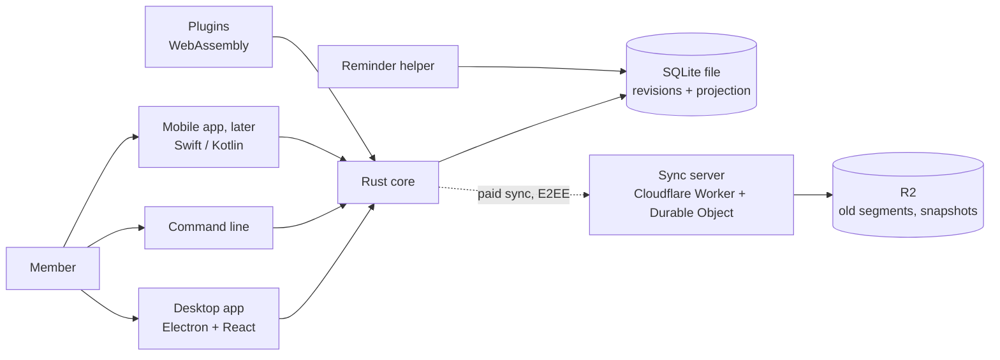
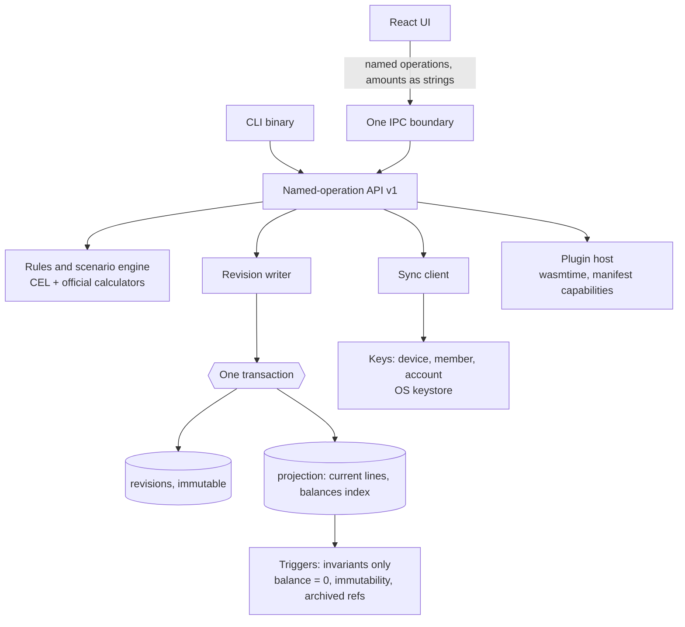
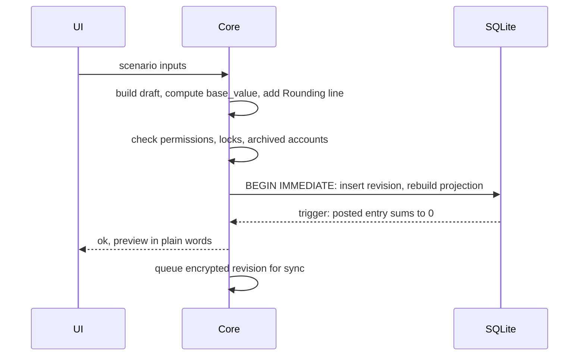
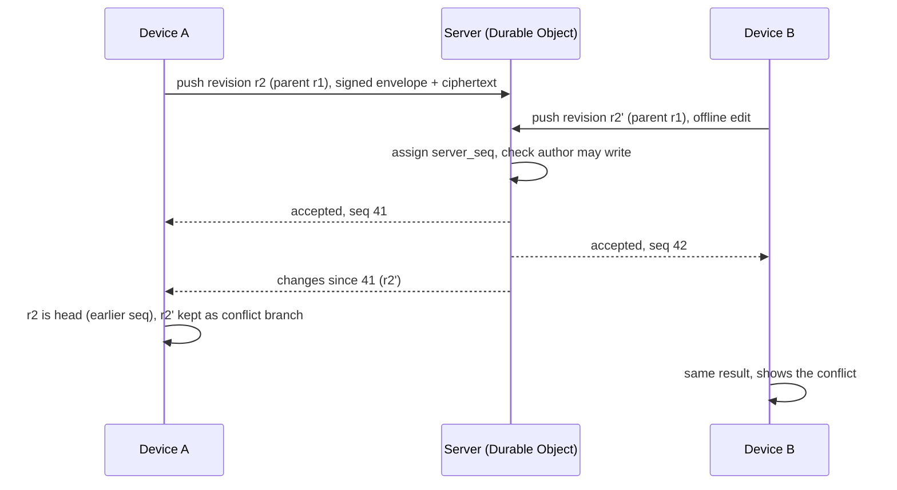
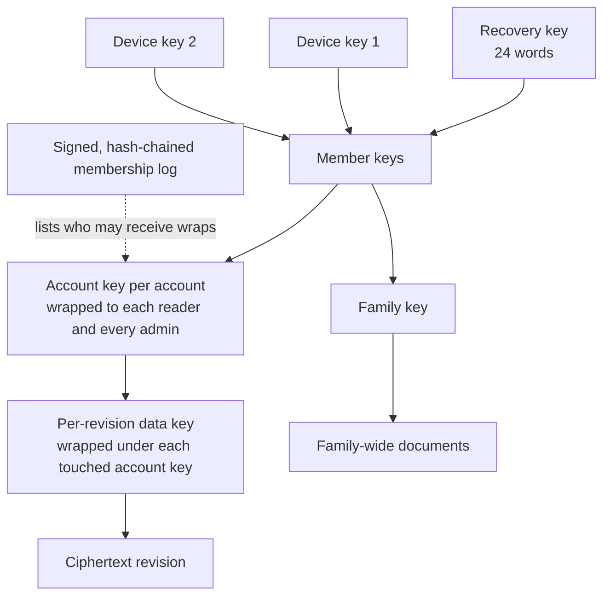
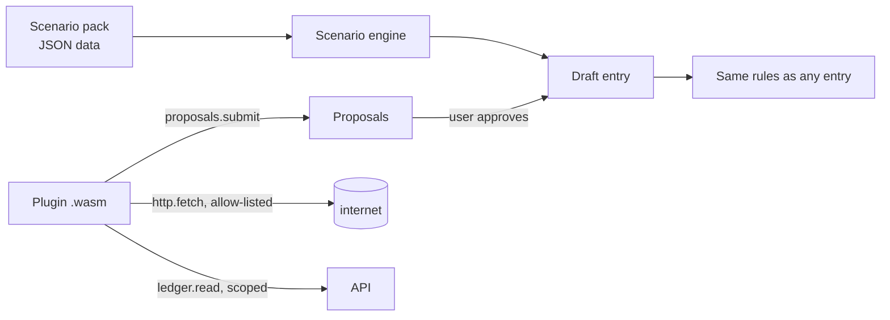
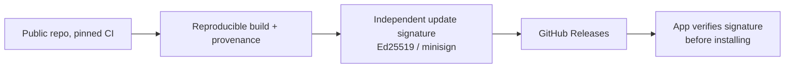

# Technical design of the rebuild

The decisions are in [ADR 0008 to 0019](../adr/README.md); the options and reviews that led to them are in [options](options/01-core-and-ui.md). This page shows how the parts fit. Diagrams use Mermaid (GitHub and Obsidian render them).

## 1. Context

## 2. Inside a device

## 3. Writing an entry (a revision)

## 4. Sync and conflicts

## 5. Key hierarchy

## 6. Plugin and scenario boundary

Rule: no plugin holds both `ledger.read` and `http.fetch`.

## 7. Release and update path

Paid sync waits for Windows and Apple signing (ADR-0018).

## Build order (proposed, story 6 refines it)
1. Core skeleton: SQLite schema, revisions, projection, `verify_projection`, amounts and rounding, the four v1 scenarios, tests ported from the prototype specs.
2. Command line (quick entry) on the same core.
3. Electron shell and the React screens for the v1 flows and reports.
4. Backup, restore, CSV export, cloud-folder refusal.
5. Per-account roles, local members and device PIN gate.
6. Release pipeline with the update key.
7. Then: investments, scenario packs, reminder helper, sync and keys, mobile.
