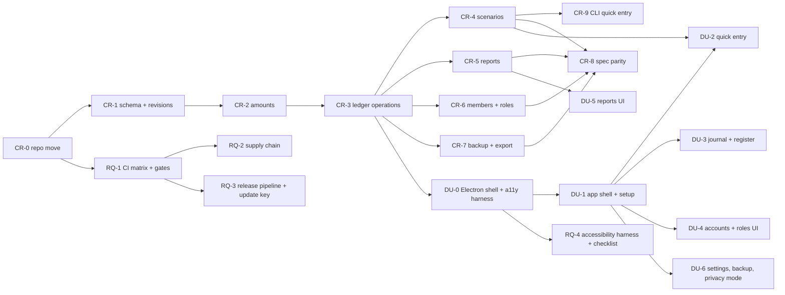

# Migration plan: from the prototype to the rebuild

Epic `foundation-reset`, story 6. Decisions: [ADR 0008 to 0019](../adr/README.md). Design: [design](design.md). Each step is one PR-sized story with tests first, `verify` green, and a commit. Stories live in `.stories/`.

## Repository move (step CR-0)
1. Tag the prototype as `prototype-final` and move its code (`src/`, `src-tauri/`, scripts, prototype tests) to `legacy/`. Specs and ADRs stay in `docs/`.
2. New layout: a Rust workspace in `crates/` (core, cli, helper later), the Electron app in `apps/desktop/`, shared UI tokens and scenario packs in `packages/`.
3. The legacy tree stays only until the core reaches spec parity (step CR-8), then it is deleted; the tag keeps it. (Done early: the owner had it deleted from `main` on 2026-10-14.)

## Epics
| Epic | Goal | Status |
|---|---|---|
| `core-rebuild` | Rust core for v1: schema, amounts, ledger, scenarios, reports, local roles, backup, CLI, spec parity | ready, first |
| `desktop-ui` | Electron + React app for the v1 flows, accessible from the first screen | ready, starts after CR-3 |
| `release-and-quality` | CI matrix, gates, supply chain, update key, release pipeline | ready, runs alongside |
| `investments` | Lots, price history, cost methods, gain/loss reports, investment scenarios | draft |
| `sync-and-server` | Protocol, conformance tests, keys, Cloudflare server, signing gate | draft |
| `mobile-and-reminders` | Reminder helper, native mobile quick entry | draft |

Story ids: CR-n is `core-rebuild-(n+1)` (CR-0 is `core-rebuild-1`, CR-9 is `core-rebuild-10`), DU-n is `desktop-ui-(n+1)`, RQ-n is `release-and-quality-n`. Sprint 6: `core-rebuild-1` to `-3` and `release-and-quality-1`. Sprint 7: `core-rebuild-4` and `-5`.

## Dependency graph (first three epics)

Parallel after CR-3: CR-4, CR-5, CR-6, CR-7 and DU-0 are independent.

## Sprint 6 (first rebuild sprint)
CR-0, CR-1, CR-2, RQ-1. Goal: a clean repository, the v1 schema with revisions and `verify_projection`, exact amounts and rounding, and a three-OS CI matrix.

## Porting the prototype
- Each prototype spec (`docs/backend/specs/**`) is tagged requirement by requirement as carried, changed or dropped in CR-8, with a test id in the new suite.
- The prototype operation names and error codes seed the new API vocabulary; the generated API reference is regenerated from the new code.
- `FINDINGS.md` items 11 and 12 are closed by design (one core boundary, key model) and verified in CR-6 and the sync epic.

## Risks
- Second-system effect: v1 stays narrow (four scenarios, three reports, local, one device).
- Rust build times: keep crates small; use `cargo check` in loops.
- Rule drift between the legacy tests and new tests during CR-8: the trace test fails when a named test disappears.
