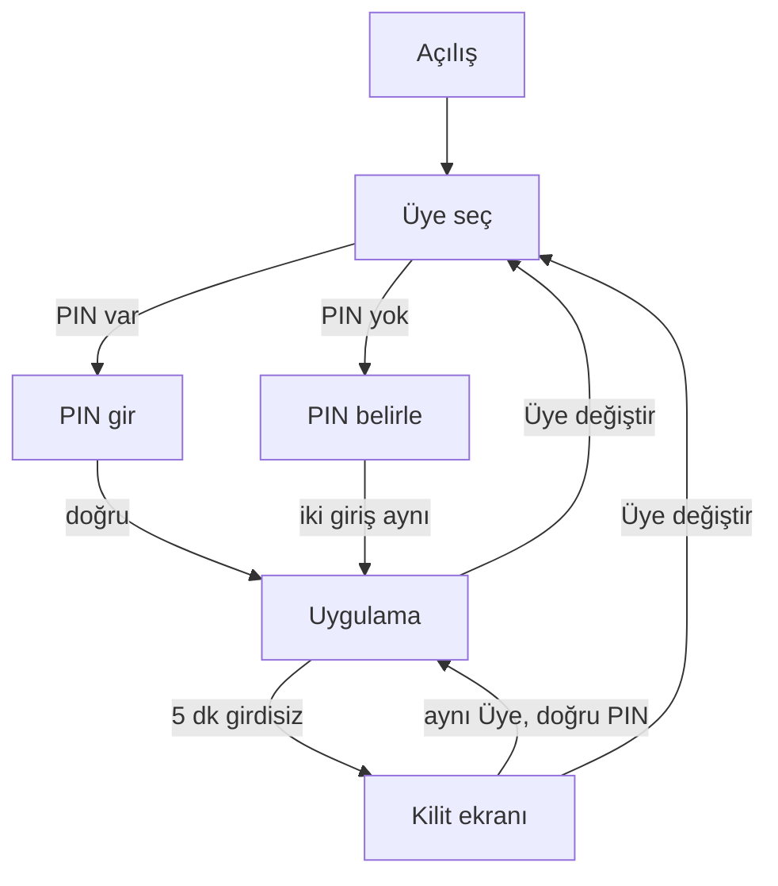

# PIN kapısı

Her Üyenin 6 haneli bir PIN'i vardır. Açılışta, Üye değiştirirken ve boşta kalınca sorulur. Plan ve kararlar: [pin-gate](../../pin-gate.md). Kurulum ve roller: [kurulum](kurulum.md).

## Temel kurallar
| Konu | Kural |
|---|---|
| Amaç | Açık uygulamayı başkasının kullanmasını engeller (aile, ziyaretçi). Dosya şifreli değildir; dosyaya erişen herkes okuyabilir. |
| Oturum | Yalnız bellekte. Sayfa yenileme veya uygulamayı kapatma kilitler. |
| PIN | 6 rakam. Ek kural yok (zayıf PIN engellenmez). |
| Boşta kilit | Girdisiz 5 dakika. Sabit; ayar yok. |
| Yanlış deneme | 5 yanlış → 30 sn bekleme. Kalıcı kilit yok. |
| Yok | Biyometri, "beni hatırla", PIN ipucu. |

## Akış

## 1. Üye seçimi
- Her açılışta ilk ekran. Üyeler listelenir (avatar, ad, rol). Son kullanılan Üye işaretli ve odaklı gelir; yoksa listedeki ilk (Yönetici).
- Enter veya tık → PIN ekranı. PIN'i olmayan Üyenin satırında küçük etiket: "PIN belirlenmedi".
- Bekleme süresindeki Üyenin satırında geri sayım görünür; başka Üye seçilebilir.

## 2. PIN ekranı
- Avatar + ad + 6 yuva. Odak yuvada. Sadece rakam kabul edilir; Geri tuşu siler.
- 6. rakam yazılınca kendiliğinden doğrulanır. Buton yok.
- Altta tek bağlantı: **Üye değiştir** (Esc de aynı).
- Doğru → uygulama Hesaplar ekranında açılır.

| Durum | Davranış |
|---|---|
| Yanlış PIN | Yuvalar boşalır, kısa sarsılma, odak yuvada. Mesaj: "PIN yanlış. Kalan deneme: N." |
| 5. yanlış | Yuvalar kapanır (devre dışı). Mesaj: "Çok fazla deneme. N sn sonra tekrar dene." N her saniye azalır. 0'da yuvalar açılır, odak yuvaya gider, 5 deneme daha. |
| Bekleme sırasında kapat/aç | Bekleme dosyada tutulur; yeniden başlatma bitirmez. |
| Doğru PIN | Yanlış sayacı sıfırlanır. |

## 3. PIN belirle (ilk giriş)
Şu durumlarda: kurulumdan önce eklenmiş mevcut Üyeler, kurulumdan sonra eklenen Üyeler, Yönetici PIN'i sıfırladıktan sonra.

- Başlık: "PIN belirle". Alt metin: "6 rakam. Bu PIN'i unutursan bir Yönetici sıfırlar."
- 1. giriş 6 rakama varınca odak "PIN'i tekrar yaz" yuvalarına geçer. 2. giriş 6 rakama varınca, ikisi aynıysa kaydedilir ve uygulama açılır.
- Aynı değilse: iki yuva boşalır, odak 1. girişe döner, mesaj "PIN'ler aynı değil. Tekrar dene." Sayaç tutulmaz.
- Kabul: PIN'i olmayan Üyeyi ilk seçen onun PIN'ini belirler (aile cihazında kabul edildi).

## 4. Üye değiştirme
- Kenar çubuğundaki Üye menüsünde tek öğe: **Üye değiştir**.
- **Üye değiştir** = kilitle: içerik gizlenir, Üye seçimine döner, seçilen Üye PIN girer. Veri silinmez. (Eski "Oturumu kapat" aynı işi yaptığı için bu adla birleşti.)

## 5. Boşta kilit
- 5 dakika klavye/fare girdisi yoksa kilit ekranı açılır: aynı Üyenin avatarı + adı + PIN yuvaları + **Üye değiştir**. Arkadaki içerik gizlenir (okunmaz).
- Doğru PIN → kalınan yere dönülur.

**Korunanlar (bellekte, Üye başına):** açık diyaloglar ve içindeki yazılı değerler, taslaklar (Hızlı Giriş, Serbest kayıt), açık sayfa, süzgeçler.

| Olay | Sonuç |
|---|---|
| Aynı Üye PIN girer | Her şey olduğu gibi devam eder. |
| Başka Üye girer | Temiz başlar (Hesaplar). Kilitlenen Üyenin durumu silinmez, saklı kalır. |
| O Üyenin daha önce saklı durumu varsa | Girince o durum geri gelir (diyaloglar, taslaklar). |
| Sayfa yenileme veya uygulamayı kapatma | Tüm durum (taslaklar dahil) kaybolur. Kilitler. Kabul edildi. |
| Yönetici o Üyenin PIN'ini sıfırlar | Saklı durumu silinir (bkz. açık soru). |
| Kilitliyken devam eden kayıt | Kayıt tamamlanır; sonuç bildirimi PIN girilince görünür. |

## 6. Ayarlar > Üyeler
| İşlem | Kim | Akış |
|---|---|---|
| PIN'i değiştir | herkes (kendi) | Mevcut PIN, yeni PIN, yeni PIN tekrar. Yanlış mevcut PIN yanlış-deneme sayacına girer. |
| PIN sıfırla | Yönetici (başka Üye; başka Yönetici dahil) | Onay: "<Ad> için PIN sıfırlansın mı? Bir sonraki girişte yeni PIN belirler." Butonlar: **Sıfırla**, Vazgeç. Bekleme sayacını da temizler. |

- Kendi PIN'ini sıfırlama yok (değiştir kullanılır).
- Sıfırlanan Üyenin satırında "PIN belirlenmedi" etiketi görünür.

## 7. PIN unutuldu
- Üye: bir Yönetici sıfırlar, Üye sonraki girişte yenisini belirler.
- Tek Yönetici unutursa uygulama içinde yolu yok. Yedekten geri yükleme o yedeğin PIN'ini getirir; yalnız eski PIN biliniyorsa işe yarar. Metin tek satır: "Tek Yönetici PIN'ini unutursa yalnız eski bir yedek (eski PIN ile) yardım eder."

## Klavye
| Ekran | Tuş | Etki |
|---|---|---|
| Üye seçimi | ↑↓ | Üye seçer. |
| Üye seçimi | Enter | PIN ekranına geçer. |
| PIN / kilit / belirle | 0–9 | Sıradaki yuvaya yazar. 6. rakam gönderir. |
| PIN / kilit / belirle | Geri tuşu | Son rakamı siler. |
| PIN / kilit / belirle | Esc | Üye seçimine döner (Üye değiştir). |
| PIN belirle | Esc | 2. girişteyken önce 1. girişe döner; 1. girişteyken Üye seçimine. |

## Henüz yok (sonra, gerekirse)
Elle kilitle düğmesi, boşta süre ayarı, zayıf PIN uyarısı (000000, 123456), dosya şifreleme (Yol Haritası: Later).

## Uygulanmadı / sapma (ekran)
- **Saklı durum, uygulandı:** Hızlı Giriş (yazılı değerlerle) ve Serbest kayıt taslağı Üye başına bellekte saklanır (`src/ui/lib/kept.ts`); boşta kilitte, Üye değiştirde ve Esc'te korunur, aynı Üye dönünce geri gelir. Yönetici PIN'i sıfırlayınca o Üyenin durumu silinir; uygulama kapanınca hepsi gider. Teknik not: yalnız etkin Üyenin ekranı bağlı kalır (Base UI modal diyaloğu belgenin geri kalanını tıklanamaz yapar), saklanan veri bir depodan geri okunur. **Henüz saklanmayanlar:** diğer diyaloglar (Hesap, Rehber, Kur, Ayarlar vb.) ve sayfa içi süzgeçler/sıralama; açık sayfa saklanır. Kullanıcı diyaloğu kendisi kapatırsa (İptal/Esc) taslak silinir.
- Bekleme sayacı Üye başına (varsayılan, onay bekliyor). Üye listesindeki geri sayım yalnız bu açılışta görülen beklemeleri gösterir; yeniden başlatmadan sonra ilk denemede öğrenilir.
- PIN ekranı dili: defter ayarı (dil) PIN girilene kadar okunamaz; sistem dili kullanılır.
