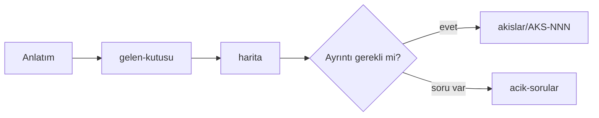

# Kullanıcı Deneyimi & Bilgi Mimarisi

Amaç: gündelik para işlerinin **tümünü** toplamak, tek akışa damıtmak, uygulamaya uyarlamak. Sahibi: [interaction-designer](../../.claude/agents/interaction-designer.md). Terimler: [GLOSSARY](../GLOSSARY.md).

**Önce oku: [harita](harita.md).** Şu an geçerli olan her şey orada: ilkeler, ana döngü, süreç tablosu, istisna kalıpları, açık sorular.

## Dosyalar
| Dosya | Rol | Güncellenir mi |
|---|---|---|
| [harita](harita.md) | **Tek doğru kaynak** | Her anlatımdan sonra |
| [gelen-kutusu](gelen-kutusu.md) | Ham anlatımlar, tarih sırası | Her anlatımda (ekleme) |
| [akislar/](akislar/_indeks.md) | Süreç başına akış ve istisnalar | Gerektiğinde |
| [acik-sorular](acik-sorular.md) | Tüm soruların ayrıntılı listesi | Gerektiğinde |
| [personalar/](personalar/README.md) | Kullanıcı tipleri | Henüz boş |
| [arsiv/](arsiv/analiz.md) | Karar tarihçesi (Anlatım 1-8) | **Dondu**. Ajanlar okumaz. |

## İşleyiş

Olgunluk ve geliştirme planı kararı ürün sahibindedir.

## Aşamalar
| # | Aşama | Durum |
|---|-------|-------|
| 1 | Toplama (anlatımlar) | Aktif |
| 2 | Damıtma ([harita](harita.md)) | Aktif |
| 3 | Uyarlama (ekran/navigasyon, mevcut uygulamayla fark) | Beklemede |
| 4 | Geliştirme planı | Beklemede, ürün sahibi onayıyla |
