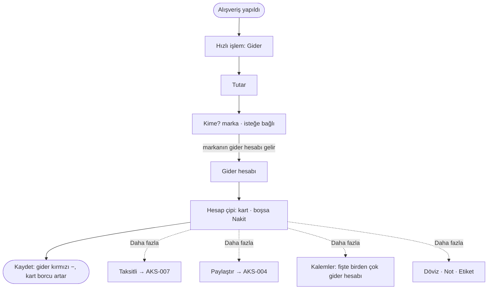

# AKS-001 — Kartla alışveriş (tek çekim)

- **Kaynak:** Anlatım 1 (2026-10-07), kararlar Anlatım 6; uygulama Hızlı işlem v3 (2026-10-08)
- **Kim:** Her kullanıcı
- **Tetikleyici:** Mağaza/siteden ürün veya hizmet alındı (banka bildirimi geldi ya da fiş var)
- **Sıklık:** Günde birkaç kez; en sık işlem
- **Hedef:** Ne kadar, nereye harcadım; kart borcum ne kadar?

## Akış

## Kararlar
- Taksit, paylaştır ve kalemler bu akışın **seçenekleridir** ("Daha fazla" altında). Tek çekim varsayılan yol. [uygulandı]
- "Kime?" isteğe bağlı; marka yazılırsa gider hesabı kendiliğinden gelir, kullanıcı değiştirebilir. Yeni ad marka olarak açılır; marka ilk kullanılan gider hesabını öğrenir ([AKS-016](AKS-016-kime-odeme-yaptim.md)). [uygulandı]
- Gider hesabı listesinde üst hesap ipucu görünür ("Taksi · Ulaşım"); Grup hesaplar ("Sadece grup") seçilemez. [uygulandı]

## İstisnalar
| Durum | Kalıp | Bugün |
|---|---|---|
| Yanlış dokundum | Geri Al | 8 sn bildirim |
| Yanlış gider hesabı, tutar, tarih, marka | Düzelt | İşlemler → işlem → düzenle |
| **Yanlış kart** | Düzelt | **Hesap düzeltilemez**; sil + yeniden gir (harita B3) |
| Mağaza iade etti (tam / kısmi) | İade | **Akış yok** (harita B1) |
| Değişim (fark ödendi / geri alındı) | İade + yeni gider | Akış yok; fark ödendiyse yeni gider girilir |
| Yurt dışı / döviz | — | Daha fazla → Döviz: para birimi, kur, bankanın TL tutarı (isteğe bağlı) |
| Fişte birden çok gider hesabı | — | Daha fazla → Kalemler; kalan ana gider hesabına |
| Banka tutarı farklı çıktı | Düzelt | Tutar düzeltilir |
| Başkasının payı var | — | Paylaştır ([AKS-004](AKS-004-hesap-bolusme.md)) |

## Sürtünme
- Çok kart: yanlış kartı seçmek kolay. Hesap çipi boşsa Nakit sayılır; kartla ödeyen kullanıcı çipi unutursa harcama nakitten düşer. İlke 2 kararı "son kart varsayılan" idi; **uygulanmadı**.

## Uygulamadaki karşılığı (şimdi)
Hızlı işlem → Gider (yukarıdaki akış). İşlemler'de düzenle yalnız tek hesaplı, ana para birimli gider/gelirde açılır.

## Açık sorular
- Banka ekstresiyle teyit pratikte nasıl yapılıyor? (banka entegrasyonu kapsam dışı)
- İade ve Düzelt kapsamı → [acik-sorular](../acik-sorular.md).
