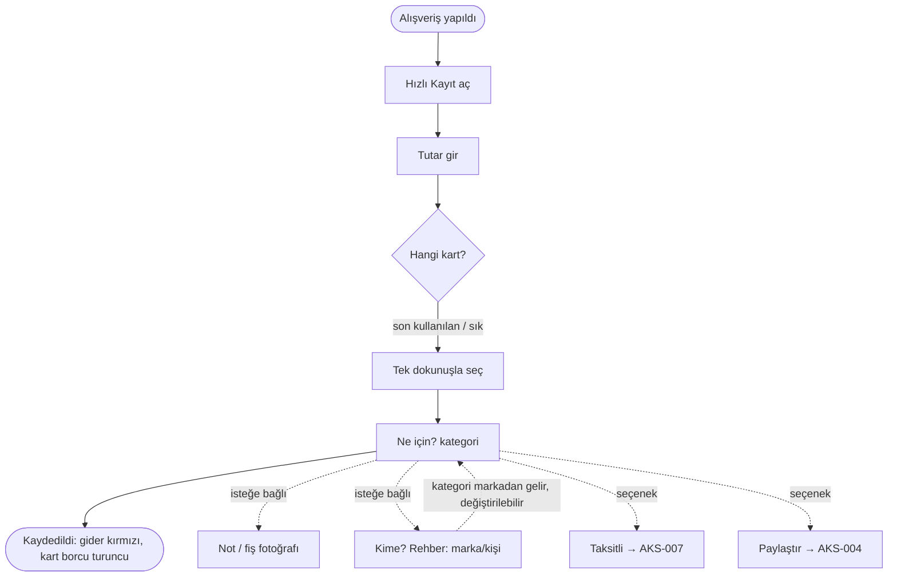

# AKS-001 — Kartla alışveriş (tek çekim)

- **Kaynak:** Anlatım 1 (2026-10-07)
- **Kim:** Her kullanıcı
- **Tetikleyici:** Mağaza/siteden ürün veya hizmet alındı (banka bildirimi geldi ya da fiş var)
- **Sıklık:** Günde birkaç kez; en sık işlem
- **Hedef:** Ne kadar, nereye harcadım; kart borcum ne kadar?

## Akış

## Kararlar (Anlatım 6)
- **Taksit** ve **paylaştır (bölüşme)** bu akışın **seçenekleridir**; ayrı ilk-ekran seçeneği değil. Tek çekim, varsayılan yol kalır.
- "Kime?" (Rehber) isteğe bağlı; marka seçilirse **kategori otomatik gelir**, kullanıcı **değiştirebilir** (aynı markanın farklı kategorileri olabilir). Marka çok firmaya bağlıysa firma seçilebilir, seçilmezse belirsiz kalır (bkz. [AKS-016](AKS-016-kime-odeme-yaptim.md)).

## Sapmalar
- Banka bildirimi/ekstresiyle teyit ihtiyacı ("bankada veriler saklandığı için teyit edebilirim") → kayıt sonradan doğrulanabilmeli.
- Yurt dışı / döviz harcama; taksit ([AKS-007](AKS-007-taksitli-alisveris.md)); bölüşme ([AKS-004](AKS-004-hesap-bolusme.md)).

## Sürtünme
- Çok kart: yanlış kartı seçmek kolay. Kart sıralaması (son kullanılan, sık) önemli.

## Uygulamadaki karşılığı
Hızlı giriş var (QuickEntry); "tek dokunuş kart + kategori" yeterince hızlı mı, ölçülmedi.

## Açık sorular
- Banka ekstresiyle teyit pratikte nasıl yapılıyor? (banka içe aktarma kapsam dışı)
