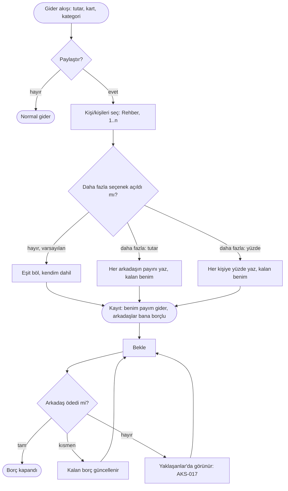

# AKS-004 — Hesabı ben ödedim, sonra bölüşürüz

- **Kaynak:** Anlatım 1, kararlar Anlatım 6
- **Kim:** Ben + 1..n arkadaş (3+ kişi olabilir)
- **Tetikleyici:** Birlikte yemek/etkinlik; tüm hesabı tek kişi (ben) kendi kartıyla ödedi
- **Sıklık:** Orta; sosyal hayata bağlı
- **Hedef:** Kendi payımı gider yazmak; arkadaşın payını "bana borçlu" olarak takip etmek; ödeşince kapatmak; ödemeyen için hatırlatma almak

## Karar (Anlatım 6)
Bölüşme ayrı bir akış değil, **Gider akışının içinde bir "paylaştır" adımı**dır ([AKS-001](AKS-001-kartla-alisveris.md)'in seçeneği). Gider normal girilir; "paylaştır" seçilirse kişiler ve paylar sorulur. Paylaşım şekilleri: **eşit, tutar bazlı, yüzdeli**; **3+ kişi** desteklenmeli.

**Güncelleme (Anlatım 7):** Yüzde/tutar seçenekleri **varsayılan ekranda gizli** kalır. Varsayılan **eşit** bölüşmedir; tutar ve yüzde ayrıntısı yalnız **"daha fazla"** altında açılır. Yani ilk dokunuşta kullanıcı kişiyi seçer, sistem eşit böler; ayrıntıya girmek isteğe bağlıdır. (Eleştiri #4'ün kabulü; bkz. [elestiri-ve-istisnalar](../arsiv/elestiri-ve-istisnalar.md).)

## Akış

## Örnekler (kullanıcıdan)
- Eşit: 2 kişi, yarı yarıya.
- Eşit değil: toplam 833,28 → benim 647,50, arkadaşın 185,78 (kuruşlu tutar; yuvarlama kuralı gerekir).
- Yeni (Anlatım 6): 3+ kişi; yüzdeli paylar (ör. %50 / %30 / %20).

## Sürtünme
- Ödeşme genelde başka kanalla olur (havale, nakit); sonradan "geldi" demek ayrı bir iş. Hatırlatma isteniyor ([AKS-017](AKS-017-hatirlatma.md)).
- Arkadaş kayıtlı kişi mi, tek seferlik isim mi? Kişiler Rehber ile birleştiği için kaynak Rehber; yeni kişi yazarken eklenir (ayrıntı sonra).
- Çok kişili yüzde/tutar girişi hızlı akışı yavaşlatır; bu yüzden varsayılan eşit, ayrıntı "daha fazla" altında (karar, Anlatım 7).

## Uygulamadaki karşılığı
Kişiler + borç/alacak var (`contact_balances`). Bölüşmenin tek adımda kurulup kurulamadığı **kontrol edilecek**. Yüzdeli paylar ve 3+ kişi mevcut modelle uyumlu mu doğrulanmalı (kişi başı alacak satırı).

## Açık sorular
- Karışık paylaşım türü, yüzde toplamı ≠ %100, yuvarlama farkı kimde kalır, benim payım 0 olabilir mi? → [acik-sorular](../acik-sorular.md) (Bölüşme)
- Arkadaş ödeyince nasıl girilir: nakit mi havale mi, hangi hesaba?
