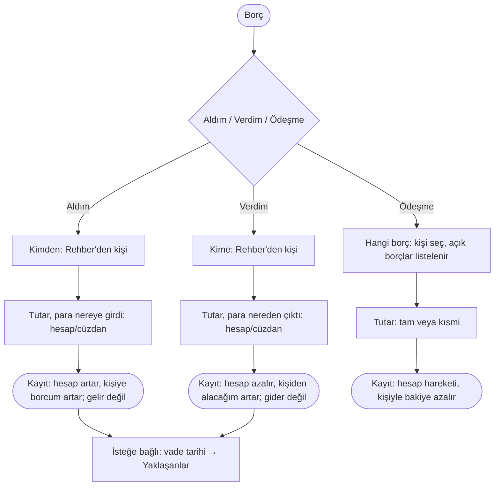

# AKS-005 — Borç (aldım / verdim): tek düğme, ikinci dokunuşla yön

- **Kaynak:** Anlatım 1 (senaryo 5-6: arkadaştan borç almak / arkadaşa borç vermek), karar **Anlatım 8**: ilk ekranda "Borç" tek düğme. **AKS-006 bu akışla birleşti** (ayrı dosya açılmayacak).
- **Kim:** Ben + Rehber'deki bireysel kişi
- **Tetikleyici:** Birine para verdim ya da birinden para aldım (veya ödeşme/geri ödeme oldu)
- **Sıklık:** Düşük-orta (kullanıcı sık işlemler listesine koydu)
- **Hedef:** Kim kime ne kadar borçlu, açıkta ne kaldı

## Karar (Anlatım 8)
İlk ekran 5 seçenek: **Gelir · Gider · Transfer · Borç · ATM**. "Borç" dokununca ikinci adım: **Aldım / Verdim** (ve ödeşme için aşağıya bakın). Gerekçe (eleştiri #7, kabul edildi): kişi aynı kişiyle iki yönde işlem yapar; tek düğme ilk ekranı sadeleştirir.

Eleştirel not: ikinci dokunuş, en sık işlemlerden birine +1 dokunuş ekler. Telafisi: ikinci adımda **son kullanılan yön** ve **son kişi** öne çıksın (doğrulanmadı: gerçek sıklık verisi yok). "Aldım/Verdim" etiketleri iki yönü açık söylemeli; "Borç" kelimesi tek başına belirsizdir (kart borcu da "borç"; bkz. renk ertelemesi).

## Akış

## İstisnalar
| Durum | Not |
|---|---|
| **Kısmi ödeme** | Ödeşme adımında tutar azsa kalan borç/alacak devreder. |
| **Tam ödeme** | Bakiye sıfır; kişi listesinde "kapandı". |
| **Bağışlandı / vazgeçildi** | Alacaktan vazgeçme = ayrı hareket; hesaptan para çıkmaz, bakiye kapanır; gider/gelir olarak sayılır mı: açık soru. |
| **Yanlış kişiye / yanlış yön** | Düzenle veya **Geri Al** (Anlatım 8); yön hatası yaygın olabilir, çünkü tek düğme. |
| **Karşı yönde borç** | Aynı kişiyle hem alacak hem borç varsa net bakiye gösterilir, kayıtlar ayrı kalır. |
| **Döviz borcu** | Öncelik düşük; para birimi kayıtla gelir. |
| **Faizli borç** | Kapsam dışı olarak etiketle; yalnız tutar takip edilir. |
| **Borç devri (A→B)** | Karmaşık; v1'de değil (varsayım). |
| **Vade yok / geçti** | Vade isteğe bağlı; varsa Yaklaşanlar'da; geçince "gecikmiş" ([AKS-017](AKS-017-hatirlatma.md)). |
| **Bölüşme ile ilişkisi** | Bölüşmeden doğan alacaklar aynı kişi bakiyesine yazılır ([AKS-004](AKS-004-hesap-bolusme.md)). |

## Uygulamadaki karşılığı (şimdi)
Mevcut kişi borç/alacak (`contact_balances`, People sayfası) var; Rehber birleşmesiyle tek yer olacak. Üçlü ikinci adım (Aldım/Verdim/Ödeşme) mevcut Hızlı Kayıt'ta nasıl karşılanıyor: kod okunmadı, kontrol edilecek.

## Açık sorular
[acik-sorular](../acik-sorular.md) (Bölüşme / borç).
