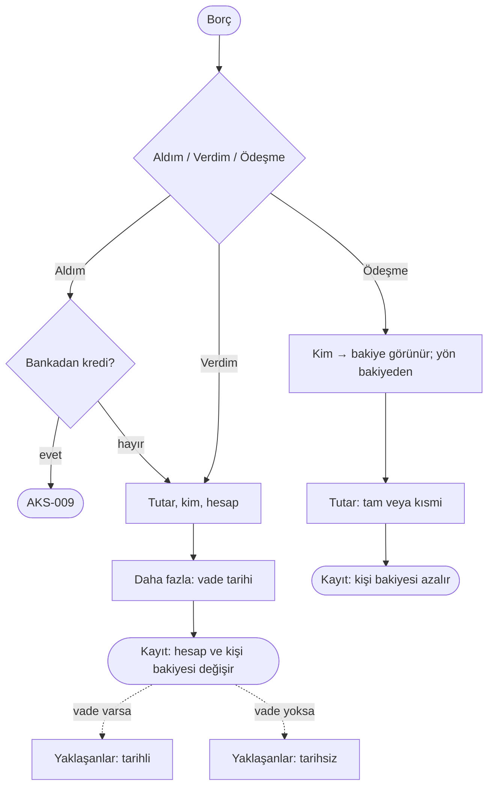

# AKS-005 — Borç (aldım / verdim / ödeşme)

- **Kaynak:** Anlatım 1 (senaryo 5-6), karar Anlatım 8 (Borç tek düğme); uygulama Hızlı Kayıt v2-v3. **AKS-006 bu akışla birleşti.**
- **Kim:** Ben + Rehber'deki kişi (kredi için banka: [AKS-009](AKS-009-kredi.md))
- **Tetikleyici:** Birine para verdim, birinden para aldım ya da ödeştik
- **Sıklık:** Düşük-orta
- **Hedef:** Kim kime ne kadar borçlu, açıkta ne kaldı

## Kararlar [uygulandı]
- Hızlı Kayıt → **Borç**; üstte üç seçenek: **Aldım · Verdim · Ödeşme**. Varsayılan "Aldım".
- Aldım'ın altında "Bankadan kredi" anahtarı → kredi formu ([AKS-009](AKS-009-kredi.md)).
- Ödeşmede kişi yazılınca bakiye görünür ("Sana X borçlu" / "Ona X borçlusun"); yön ("O bana ödedi" / "Ben ona ödedim") bakiyeden gelir, değiştirilebilir.
- Hesap çipi: boşsa Nakit; banka ya da kredi kartı seçilebilir.
- Daha fazla → **Vade tarihi** (Aldım/Verdim'de) ve Etiket. Vade girilirse Yaklaşanlar'da tarihli satır olur.
- Borç gelir ya da gider değildir; yalnız para ve kişi bakiyesi değişir.

## Akış

## İstisnalar
| Durum | Kalıp | Bugün |
|---|---|---|
| Kısmi ödeme | Kısmi | Kalan bakiye listede kalır |
| Tam ödeme | Kapanış | Bakiye 0 → Yaklaşanlar'dan kalkar |
| Yanlış kişi / yön / tutar | Geri Al / Sil | Borç kaydı düzeltilemez; sil + yeniden gir |
| Vade geldi, ödenmedi | — | Gecikmiş (kırmızı); "Ertele" +7 gün |
| Bağışlandı / vazgeçildi | Kapanış | "Vazgeç" yalnız hatırlatmayı kaldırır; bakiye kalır (harita B4) |
| Karşı yönde borç | — | Tek net bakiye görünür |
| Eski borç (başlangıçta) | — | Para hareketi olmadan giriş yok ([AKS-019](AKS-019-baslangic.md)) |
| Döviz borcu, faizli borç, borç devri | — | ⏸ Ertelendi |
| Bölüşmeden doğan alacak | — | Aynı kişi bakiyesine yazılır ([AKS-004](AKS-004-hesap-bolusme.md)) |

## Sürtünme
- "Son kullanılan yön öne çıksın" kararı uygulanmadı; hep "Aldım" açılır. Yön hatası Geri Al ile düzelir.

## Uygulamadaki karşılığı (şimdi)
Yukarıdaki akış. Kişi bakiyesi Rehber'de ve Yaklaşanlar'da görünür; Yaklaşanlar'daki "Ödeşme" kişi ve tutarı doldurur.

## Açık sorular
[acik-sorular](../acik-sorular.md) (Önce cevaplanmalı: vazgeçme; Bölüşme / borç).
