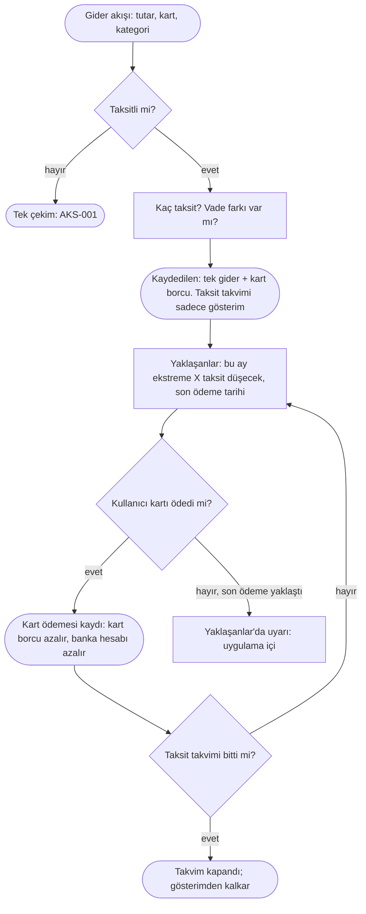

# AKS-007 — Taksitli kart alışverişi

- **Kaynak:** Anlatım 1 (senaryo 6), karar Anlatım 6; **yeniden yazıldı: Anlatım 7 (2026-10-07, "gerçekleşen esaslı")**
- **Kim:** Her kullanıcı
- **Tetikleyici:** Kartla alışveriş yapılırken ödeme taksitli seçildi
- **Sıklık:** Orta
- **Hedef:** Ne aldım, toplam ne kadar, bu ay ekstreme kaç taksit düşecek, kaç taksit kaldı. Gider bir kez, doğru günde yazılsın; ekstredeki taksitler yeni gider sayılmasın.

## Temel ilke (Anlatım 7)
**Gerçekleşmemiş hiçbir işlem kayıt olmaz.** Taksitli alışveriş **tek bir gerçekleşen olaydır**: ürün alındı, kart borcu doğdu.

Örnek: X mağazası, 10.000 TL ürün, 10 taksit, vade farksız.
- **Alışveriş anında kayıt (tek):** 10.000 TL **gider** (kategori) + 10.000 TL **kredi kartı borcu**.
- **Her ay:** banka ekstreye 1.000 TL taksit yazar. Bu **yeni gider değil, kayıt da değil**; yalnız **gösterim/hatırlatma** ("Ekstre taksit takvimi": bu ay 1.000, kalan 9 taksit, kalan 9.000).
- **Kart borcunun azalması = gerçekleşen kart ödemesi** (kullanıcı kartı ödediğinde, ödediği tutarla). Taksit "ödendi" diye ayrıca işaretlenmez; takvim, kartın ödemelerinden bağımsızdır.

Önceki yargımın düzeltilmesi: "gelecek taksitler tahmin mi, kayıt mı" diye bir çelişki **yoktu**; ben Plan'ı kayıt gibi düşünmüştüm. Doğrusu: Plan = kayıt değil, gösterim/hatırlatma (bkz. [elestiri-ve-istisnalar](../arsiv/elestiri-ve-istisnalar.md)).

## Karar (Anlatım 6, geçerli)
Taksitli alışveriş **Gider'in bir seçeneği**dir. [AKS-001](AKS-001-kartla-alisveris.md) akışı aynen başlar; "taksitli" seçilirse taksit sayısı sorulur.

## Akış

## İstisnalar / sapmalar (tüm ihtimaller)
| Durum | Ne olur (kayıt / gösterim) |
|---|---|
| **Vade farksız taksit** | Yukarıdaki ana akış. |
| **Vade farkı / faizli taksit** (ör. 10.000 ürün, toplam 11.200) | Açık karar: banka çoğunlukla toplamı baştan kart borcuna yazar. Öneri: alışverişte **10.000 gider (kategori)** + **1.200 faiz/vade farkı gideri (ayrı kalem)**, kart borcu 11.200; çünkü borç gerçekleşti. Bankanın farkı taksit taksit ekstreye yansıttığı kartlarda ise fark, yansıdığı ekstrede kaydedilir. Kullanıcı hangisi olduğunu bankasından biliyor mu: soru açık. |
| **İade (tam)** | Mağaza iade eder: gider **ters yazılır** (kategori düşer), kart borcu aynı tutarda azalır. Banka kalan taksitleri iptal eder; takvim kapanır. Ödenmiş taksitlerin karşılığı kart hesabına **alacak** olarak döner (banka bazen karta, bazen hesaba yatırır); gerçekten yatan yer ve tutar elle girilir. |
| **İade (kısmi)** | Aynı, iade tutarı kadar. Takvim yeniden hesaplanır (banka genelde son taksitlerden düşer; gerçek ekstre esas, gösterim ona uyar). |
| **Değişim** | İade + yeni alışveriş yerine tek net hareket (fark öder/alır) mümkün; taksit sayısı değişmişse yeni takvim. |
| **Erken kapama** (kalan taksitleri tek seferde öde) | Kayıt: yalnız **gerçekleşen kart ödemesi**. Banka kalan faizi siliyorsa ödenen tutar kayıtlı borçtan küçük kalır; fark "banka indirimi" olarak kart borcunu kapatan düzeltme (faiz giderini azaltır). Takvim kapanır. |
| **Taksit vade farklı / ekstreye farklı yansıdı** | Gösterim bankanın gerçek ekstresine uydurulur; kullanıcı bir taksit tutarını elle düzeltebilmeli. Kayıt etkilenmez (kart borcu zaten toplam). |
| **Ekstre kesim günü** | Kesimden sonraki alışveriş **bir sonraki ekstreye** düşer, ilk taksit bazen sonraki ay görünür. Kart başına kesim günü ve son ödeme günü bilgisi; takvim buradan türetilir. Kullanıcı tarihi değiştirebilir. |
| **Son ödeme tarihi** | "Yaklaşanlar"da görünür (uygulama içi). Geçerse "gecikmiş" görünür. |
| **Kartı kısmen / asgari ödedi** | Kart borcu yalnız ödenen kadar azalır; kalan devreder. Bankanın yazdığı **akdi/gecikme faizi** ekstrede gerçekleşince **gider** olarak elle kaydedilir. Taksit takvimi etkilenmez. |
| **Geç ödeme** | Gecikme faizi/ücreti gerçekleşince gider. Önceden tahmini kayıt yok. |
| **Taksit ertelendi / yapılandırıldı** | Bankanın yeni planı gerçekleşince: kart borcu → kredi/yapılandırma kaydına dönüşür (bkz. [AKS-009](AKS-009-kredi.md)). Eski takvim kapanır. |
| **Geçmişte alınmış, sürmekte olan taksit** (açılış) | Gider geçmişte yazılmıştır, bugün yalnız **kalan kart borcu** girilir (açılış bakiyesi), takvim "kalan N taksit" ile başlar. Geçmiş gideri tekrar yazmak raporu bozar. |
| **Kart kapandı / yenilendi** | Borç sürer; kart "kapalı ama borcu var" görünür. Takvim aynı kartta kalır. |
| **Paylaştır + taksit** | Alışverişin tamamı gider/kart borcu olur; arkadaş payı [AKS-004](AKS-004-hesap-bolusme.md)'teki gibi alacak olarak yazılır. Arkadaş ödemesi taksit takvimine bağlı değildir. |
| **Yabancı para taksit** | Kart borcu TL'ye bankanın kuruyla yansır; gerçekleşen TL ekstreye göre elle düzeltilir (kur farkı). |
| **Yanlış girdim** | Düzenle/sil: gider ve kart borcu birlikte düzelir; takvim yeniden türetilir. |
| **Fiş/onay yok, banka tutarı farklı** | Ekstrede çıkan tutar esas (kullanıcı düzeltir). |

## Sürtünme & duygu
- "Bu ay ne kadar taksit ödeyeceğim?" görülmek istenir: takvim buna cevap verir (gösterim).
- Aylık elle taksit girişi **yok**; kullanıcı yalnız alışverişi girer, ve kartı ödediğinde kart ödemesini girer.
- Yanlış anlama riski: kullanıcı "taksit ödedim"i ayrı bir iş sanabilir. Kart ödemesi tek eylem; taksitler yalnız bilgidir.

## Uygulamadaki karşılığı (şimdi) — KONTROL EDİLECEK
Kod okunmadı; yalnız not. Mevcutta `installment-create/pay` Edge Function'ları ve ayrı Taksitler sayfası var. İlkeyle uyumu kontrol edilmeli:
- `installment-create` alışverişte **tek gider + kart borcu** mu yazıyor, yoksa her taksit için ayrı gider/borç satırı mı oluşturuyor (çifte sayım riski)?
- `installment-pay` taksit ödemesini **gerçek kart ödemesi** olarak mı kaydediyor, yoksa "taksit ödendi" ayrı bir olay mı (gerçekleşmemiş/ikili kayıt riski)?
- Gelecek taksitler **kayıt (ileri tarihli satır)** olarak mı tutuluyor? Öyleyse "gerçekleşmemiş kayıt yok" ilkesiyle çelişir; takvim gösterim olmalı.
- İade, erken kapama, vade farkı, kesim/son ödeme günü modelde karşılık buluyor mu?
- Giriş yolu "Gider'in seçeneği" kararıyla değişecek (ekran önerisi yok).

## Notlar / açık sorular
Bkz. [acik-sorular](../acik-sorular.md) (Taksitli alışveriş).
