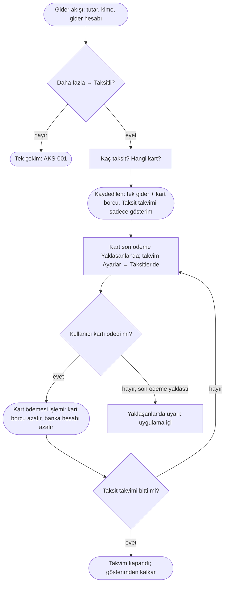

# AKS-007 — Taksitli kart alışverişi

- **Kaynak:** Anlatım 1 (senaryo 6), karar Anlatım 6; yeniden yazıldı Anlatım 7; **uygulandı 2026-10-07** (Gider → Daha fazla → Taksitli)
- **Kim:** Her kullanıcı
- **Tetikleyici:** Kartla alışveriş yapılırken ödeme taksitli seçildi
- **Sıklık:** Orta
- **Hedef:** Ne aldım, toplam ne kadar, bu ay ekstreme kaç taksit düşecek, kaç taksit kaldı. Gider bir kez, doğru günde yazılsın; ekstredeki taksitler yeni gider sayılmasın.

## Temel ilke (Anlatım 7)
**Gerçekleşmemiş hiçbir olay işlem olmaz.** Taksitli alışveriş **tek bir gerçekleşen olaydır**: ürün alındı, kart borcu doğdu.

Örnek: X mağazası, 10.000 TL ürün, 10 taksit, vade farksız.
- **Alışveriş anında işlem (tek):** 10.000 TL **gider** (gider hesabı) + 10.000 TL **kredi kartı borcu**.
- **Her ay:** banka ekstreye 1.000 TL taksit yazar. Bu **yeni gider değil, işlem de değil**; yalnız **gösterim/hatırlatma** ("Ekstre taksit takvimi": bu ay 1.000, kalan 9 taksit, kalan 9.000).
- **Kart borcunun azalması = gerçekleşen kart ödemesi** (kullanıcı kartı ödediğinde, ödediği tutarla). Taksit "ödendi" diye ayrıca işaretlenmez; takvim, kartın ödemelerinden bağımsızdır.

## Karar (Anlatım 6, geçerli)
Taksitli alışveriş **Gider'in bir seçeneği**dir. [AKS-001](AKS-001-kartla-alisveris.md) akışı aynen başlar; "Taksitli" seçilirse taksit sayısı (2-36) ve kart sorulur, "Aylık yaklaşık X" gösterilir. Tek kart varsa seçili gelir. İlk taksit tarihi kartın kesim/son ödeme gününden türer. [uygulandı]

## Akış

## İstisnalar / sapmalar (tüm ihtimaller)
| Durum | Ne olur (işlem / gösterim) |
|---|---|
| **Vade farksız taksit** | Yukarıdaki ana akış. |
| **Vade farkı / faizli taksit** (ör. 10.000 ürün, toplam 11.200) | Karar yok; ekran yok. Kredide karar var: fark işlem günü maliyet gideri. [öneri] Aynısı: alışverişte 10.000 gider (gider hesabı) + 1.200 maliyet gideri, kart borcu 11.200. Bugün kullanıcı 11.200'ü tek gider hesabına girer (Kalemler taksitle birlikte kapalı). |
| **İade (tam)** | Mağaza iade eder: gider **ters yazılır** (gider hesabı düşer), kart borcu aynı tutarda azalır. Banka kalan taksitleri iptal eder; takvim kapanır. Ödenmiş taksitlerin karşılığı karta **artı bakiye** olarak döner (banka bazen karta, bazen hesaba yatırır); gerçekten yatan yer ve tutar elle girilir. |
| **İade (kısmi)** | Aynı, iade tutarı kadar. Takvim yeniden hesaplanır (banka genelde son taksitlerden düşer; gerçek ekstre esas, gösterim ona uyar). |
| **Değişim** | İade + yeni alışveriş yerine tek net işlem (fark öder/alır) mümkün; taksit sayısı değişmişse yeni takvim. |
| **Erken kapama** (kalan taksitleri tek seferde öde) | İşlem: yalnız **gerçekleşen kart ödemesi**. Banka kalan faizi siliyorsa ödenen tutar kart borcundan küçük kalır; fark "banka indirimi" olarak kart borcunu kapatan düzeltme (faiz giderini azaltır). Takvim kapanır. |
| **Taksit vade farklı / ekstreye farklı yansıdı** | Gösterim bankanın gerçek ekstresine uydurulur; kullanıcı bir taksit tutarını elle düzeltebilmeli. İşlem etkilenmez (kart borcu zaten toplam). |
| **Ekstre kesim günü** | Kesimden sonraki alışveriş **bir sonraki ekstreye** düşer, ilk taksit bazen sonraki ay görünür. Kart başına kesim günü ve son ödeme günü bilgisi; takvim buradan türetilir. Kullanıcı tarihi değiştirebilir. |
| **Son ödeme tarihi** | "Yaklaşanlar"da görünür (uygulama içi). Geçerse "Gecikti" görünür. |
| **Kartı kısmen / asgari ödedi** | Kart borcu yalnız ödenen kadar azalır; kalan devreder. Bankanın yazdığı **akdi/gecikme faizi** ekstrede gerçekleşince **gider** olarak elle girilir. Taksit takvimi etkilenmez. |
| **Geç ödeme** | Gecikme faizi/ücreti gerçekleşince gider. Önceden tahmini işlem yok. |
| **Taksit ertelendi / yapılandırıldı** | Bankanın yeni ödeme takvimi gerçekleşince: kart borcu → kredi/yapılandırma işlemine dönüşür (bkz. [AKS-009](AKS-009-kredi.md)). Eski takvim kapanır. |
| **Geçmişte alınmış, sürmekte olan taksit** (açılış) | Gider geçmişte yazılmıştır, bugün yalnız **kalan kart borcu** girilir (açılış bakiyesi), takvim "kalan N taksit" ile başlar. Geçmiş gideri tekrar yazmak raporu bozar. |
| **Kart kapandı / yenilendi** | Borç sürer; kart "kapalı ama borcu var" görünür. Takvim aynı kartta kalır. |
| **Paylaştır + taksit** | Alışverişin tamamı gider/kart borcu olur; arkadaş payı [AKS-004](AKS-004-hesap-bolusme.md)'teki gibi "bana borçlu" olarak yazılır. Arkadaş ödemesi taksit takvimine bağlı değildir. |
| **Yabancı para taksit** | Kart borcu TL'ye bankanın kuruyla yansır; gerçekleşen TL ekstreye göre elle düzeltilir (kur farkı). |
| **Yanlış girdim** | Düzenle/sil: gider ve kart borcu birlikte düzelir; takvim yeniden türetilir. |
| **Fiş/onay yok, banka tutarı farklı** | Ekstrede çıkan tutar esas (kullanıcı düzeltir). |

## Sürtünme & duygu
- "Bu ay ne kadar taksit ödeyeceğim?" görülmek istenir: takvim buna cevap verir (gösterim).
- Aylık elle taksit girişi **yok**; kullanıcı yalnız alışverişi girer, ve kartı ödediğinde kart ödemesini girer.
- Yanlış anlama riski: kullanıcı "taksit ödedim"i ayrı bir iş sanabilir. Kart ödemesi tek eylem; taksitler yalnız bilgidir.

## Uygulamadaki karşılığı (şimdi)
- Alışverişte **tek gider + kart borcu** yazılır; takvim ayrı tablo, işlem değil. İlkeyle uyumlu. [uygulandı]
- Taksit "ödendi" diye işaretlenmez; kart borcu Transfer → kart ile azalır. [uygulandı]
- Takvim Ayarlar → Taksitler'de, aya göre toplamlı. Yaklaşanlar'da yok (harita B6).
- **Uyumsuzluk:** Yaklaşanlar'daki kart son ödeme tutarı kesimdeki kart borcunun tamamıdır; ekstreye düşmemiş taksitleri de içerir (harita B2).
- Vade farkı, iade, erken kapama, süren taksit açılışı için ekran yok.
- Taksit yalnız ana para birimli kredi kartında; kalemler ve döviz ile birlikte kullanılmaz; paylaştır ile kullanılır.
- Ödenmiş taksiti olan eski alışveriş silinemez.

## Notlar / açık sorular
Bkz. [acik-sorular](../acik-sorular.md) (Taksitli alışveriş).
