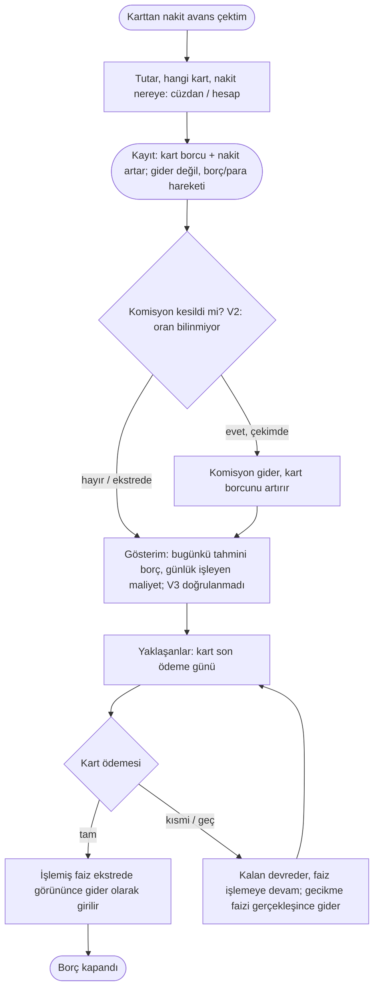

# AKS-008 — Nakit avans (kredi kartından nakit çekmek)

- **Durum:** TASLAK, **varsayımsal** (Anlatım 8: ürün sahibi "varsayımsal ve Türkiye Finans standartlarını araştırarak ilerle" dedi). Kullanıcı gerçek akışı anlatana ve banka bilgileri teyit edilene kadar aşağıdaki her şey onaylanmamıştır.
- **Kaynak:** Anlatım 1 (senaryo 7), Anlatım 5 ("ilk sürümde gerekli, son zamanlarda çok sık"), karar Anlatım 7 (ilk sürümde VAR), araştırma Anlatım 8
- **Kim:** Ben
- **Tetikleyici:** Kartla ATM'den/şubeden nakit çektim (veya karttan hesaba nakit avans aldım)
- **Sıklık:** Son zamanlarda sık
- **Hedef:** (anlatılacak) Çekilen tutarı, faiz/komisyon maliyetini, ne zaman ödeyeceğimi görmek

## Araştırma bulguları ve varsayımlar (Anlatım 8)
Her satır "varsayım" etiketlidir; kesin bilgi değildir.

| # | Varsayım | Kaynak | Güven |
|---|---|---|---|
| V1 | Nakit avansta **TCMB'nin açıkladığı aylık azami akdi faiz tavanı** uygulanır. Haberlerde 2026 öncesi %4,42'den %5'e çıkarıldığı yazıyor; **güncel oran doğrulanmadı.** | Haber siteleri (TCMB tavanı) | Düşük-orta |
| V2 | **Türkiye Finans'a özgü** nakit avans oranı ve komisyonu **bulunamadı.** | Aramada çıkmadı | Bilinmiyor, **ürün sahibi teyit etsin** (kart sözleşmesi/ücret tarifesi) |
| V3 | Nakit avansta faiz genellikle **çekim anından itibaren günlük** işler; ekstre kesimi beklenmez (alışverişteki faizsiz dönem yok). | Genel bilgi | **Doğrulanmadı** |
| V4 | Bankalar **dönemsel faizsiz nakit avans kampanyası** yapabilir. | Genel/haber | Doğrulanmadı |
| V5 | Katılım bankası kartında terim "faiz" yerine "kâr payı/ücret" olabilir; nakit avansta nasıl adlandırıldığı bilinmiyor. | Çıkarım | Düşük |

Etkisi: borç **zamanla büyür** (günlük işleyen maliyet); bu yüzden kullanıcıya gösterilecek "bugünkü tahmini borç" bir **gösterimdir**, kayıt değildir. Kayıt yalnız ekstrede/ödemede gerçekleşen faiz ve komisyondur.

## Akış (varsayımsal, gerçekleşen esaslı)

## İstisnalar / sapmalar (matris)
| Durum | Not |
|---|---|
| **Komisyon** (çekim anında) | Gerçekleşince gider; kart borcunu artırır. Oran Türkiye Finans için **teyit bekliyor** (V2). |
| **Günlük işleyen faiz** | Ekstrede/ödemede gerçekleşen tutar gider olarak elle girilir (tahmini kayıt yok). Bugünkü tahmini borç yalnız gösterim (V1 tavan oranı kullanıcı ayarı olabilir; **varsayım**). |
| **Faizsiz kampanya** (V4) | Kampanya varsa faiz sıfır; komisyon kalabilir. Kullanıcı gerçek tutarı girdiği için kayıt etkilenmez; gösterim "kampanyalı mı" bilgisini gerektirir (isteğe bağlı alan, öncelik düşük). |
| **Nakdin gideceği yer** | Cüzdan (ATM) ya da banka hesabı; ATM kuralına benzer otomatik cüzdan. |
| **Taksitli geri ödeme** | Bazı bankalar nakit avansı taksitlendirir; bu durumda [AKS-009](AKS-009-kredi.md) (kredi) ve [AKS-007](AKS-007-taksitli-alisveris.md) ilkesine yaklaşır. Türkiye Finans'ta var mı: bilinmiyor. |
| **Erken kapama** | Kart ödemesi ile; işlemiş faiz kadarı gider. Günlük işlediği için erken ödeme faizi azaltır (V3). |
| **Gecikme** | Gecikme faizi/ücreti gerçekleşince gider; Yaklaşanlar'da son ödeme görünür. |
| **Kısmi ödeme** | Kalan kart borcu; nakit avans ekstrede ayrı kalem olabilir (hangi kalemin kapandığı sorusu). |
| **İptal / iade** | ATM'den çıkmayan para, banka iade eder: ters hareket; komisyon iadesi de. **Geri Al** (Anlatım 8) yalnız uygulamadaki yanlış kaydı geri çeker, bankanın iadesini değil. |
| **Yanlış girdim** | Düzenle/sil/Geri Al; kart borcu ve nakit birlikte düzelir. |
| **Yabancı para** | Yurt dışı nakit avans: kur farkı + komisyon, elle düzeltme. |

## Sürtünme & duygu
Henüz anlatılmadı. Sık kullanıldığına göre kullanıcı maliyeti net görmek isteyebilir (varsayım). Günlük işleyen faiz (V3) doğruysa "ne kadar ödeyeceğim" sürekli değişir; bu kaygı ve kaçınma yaratabilir (varsayım).

## Uygulamadaki karşılığı (şimdi)
Kapsam kararı: ilk sürümde var. Modelde nakit avans tipi, faiz/komisyon kategorisi karşılığı kontrol edilecek (uyumsuzluk adayı). Günlük artan borç gösterimi için kart başına nakit avans oranı alanı yok olabilir.

## Notlar / açık sorular
[acik-sorular](../acik-sorular.md) (Nakit avans ve kredi; "Ürün sahibinin teyit edeceği banka bilgileri").
