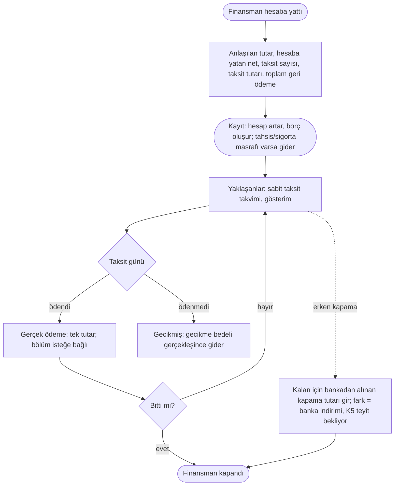

# AKS-009 — Kredi kullanmak (ihtiyaç finansmanı, yapılandırma)

- **Durum:** TASLAK, **varsayımsal** (Anlatım 8: ürün sahibi "varsayımsal ve Türkiye Finans standartlarını araştırarak ilerle" dedi). Gerçek akış anlatılmadı; sözleşme/ön bilgilendirme formundan teyit edilmedi.
- **Kaynak:** Anlatım 1 (senaryo 8), Anlatım 5, karar Anlatım 7 (ilk sürümde VAR), araştırma Anlatım 8
- **Kim:** Ben
- **Tetikleyici:** Banka kredi/finansman verdi (para hesabıma yattı) ya da borcum yapılandırıldı
- **Sıklık:** Son zamanlarda sık
- **Hedef:** (anlatılacak) Kalan borç, taksit takvimi, toplam maliyet görmek

## Araştırma bulguları ve varsayımlar (Anlatım 8)
Her satır "varsayım" etiketlidir. Kaynak: Türkiye Finans Bankacılık İşlemleri Sözleşmesi Bireysel (madde 4.9, 5, 6), ihtiyaç finansmanı sayfaları, hesapkurdu/teklifimgelsin/hesap.com karşılaştırma sayfaları.

| # | Varsayım | Güven |
|---|---|---|
| K1 | Katılım bankasında ürün **faiz değil kâr payıdır.** İhtiyaç finansmanı **murabaha**: banka ürünü peşin alıp vadeli satar, fiyat farkı = kâr payı. | Orta (genel ürün tanımı) |
| K2 | **Toplam geri ödeme sözleşmede baştan sabit.** Değişken faiz yok; taksitler sabit, genelde aylık. Önceki taslaktaki "KMH / değişken faiz / oran değişimi" satırları **bu ürün için geçersiz olabilir.** | Orta, doğrulanmadı |
| K3 | Masraflar: **tahsis ücreti, sigorta (hayat/ferdi kaza), KKDF ve BSMV.** Tahsis ücreti/sigorta kredi tutarından **düşülebilir** (net ele geçen < anlaşma tutarı) veya **ayrı ödenir.** | Düşük-orta |
| K4 | Örnek oranlar (aylık ~%3,9-5,8, 12-36 ay) karşılaştırma sitelerinden; **güvenilmez, kesin kabul edilmesin.** Kullanıcı kendi sözleşmesindeki tutarları girer; uygulama oran varsaymaz. | Düşük |
| K5 | **Erken kapama masrafı/tazminatı: BULUNAMADI.** Yalnız karz yöntemi formunda "erken ödemede kâr payı erken ödeme tarihine göre hesaplanır" (kâr payı indirimi) ifadesi var. Murabaha ihtiyaç finansmanında geçerli mi: bilinmiyor. | **Ürün sahibi teyit etsin** |

## Gerçekleşen esaslı ilke (kredi için)
- **Kredi kullanımı anında:** hesaba yatan **net** tutar + toplam geri ödeme borcu. K2 doğruysa borç baştan bilinir: **toplam geri ödeme (anapara + kâr payı)**. Fark = toplam maliyet.
  - **Seçenek (karar bekliyor):** (a) borç olarak toplam geri ödemeyi yaz, kâr payı farkını hemen gider say; ya da (b) borç olarak yalnız ele geçen tutarı yaz, her taksitte kâr payı bölümünü gider say. **Bu, vade farkı kararıyla aynı soru ailesi (açık soru, karar YOK).** Kayıt = gerçekleşen ilkesi ve [AKS-007](AKS-007-taksitli-alisveris.md) yaklaşımı (tutarın tamamı baştan borç) (a)'ya yakın; ama (b) "gerçekleşen ödeme" ilkesine yakın.
- **Masraflar:** tahsis/sigorta gerçekleştiği gün gider. Tutardan düşülmüşse: hesaba yatan net, gider = düşülen kısım (kullanıcı iki sayıyı da girer: anlaşılan tutar ve hesaba yatan).
- **Taksit takvimi:** gösterim/hatırlatma (Yaklaşanlar), kayıt değil.
- **Her gerçek taksit ödemesi:** hesaptan çıkan tutar kayıt olur; borç azalır. Bölüşüm (anapara/kâr payı/vergi) sözleşme planından; kullanıcı tek tutar girer, bölüm isteğe bağlı.

## Akış (varsayımsal)

## İstisnalar / sapmalar (matris)
| Durum | Not |
|---|---|
| **Kâr payı / tahsis / sigorta / KKDF-BSMV** | Gerçekleşince gider. Sabit planda toplam baştan bilinir (K2). |
| **Net ele geçen ≠ anlaşılan tutar** (K3) | Kullanıcı iki tutarı da girer; fark masraf gideri. Sigorta/tahsis ayrı ödendiyse ayrı kayıt. |
| **Taksitli geri ödeme** | Normal akış; sabit taksit, takvim gösterim. |
| **Erken kapama** | Kalan borç + (varsa) masraf; kâr payı indirimi olabilir (K5 teyit bekliyor). Gerçek ödenen esas; fark "banka indirimi" düzeltmesi ([AKS-007](AKS-007-taksitli-alisveris.md) ile aynı kalıp). |
| **Kısmi erken ödeme** | Borç azalır; takvim yeniden hesaplanır mı (bankanın yeni planı esas); murabaha'da var mı bilinmiyor. |
| **Gecikme** | Gecikme bedeli gider; Yaklaşanlar'da "gecikmiş". Katılım bankasında gecikme için faiz değil farklı adlandırma olabilir (bilinmiyor). |
| **Kısmi ödeme** (taksiti eksik ödedi) | Kalan taksit devreder; takvim bankaya göre. |
| **Kredi iptali (cayma)** | Hesaba yatan para geri ödenir, masraflar iade/gider: ters hareket. |
| **Yapılandırma** | Eski borç kapanır, yeni plan açılır; fark gerçekleşen tutardan. |
| **KMH (ek hesap)** | Ayrı ürün; eksi bakiye. Bu üründen ayrı tutulur; katılım bankasında nasıl işlediği bilinmiyor, öncelik düşük. |
| **Değişken faiz / oran değişimi** | K2'ye göre ihtiyaç finansmanında **yok**; yalnız farklı kredi türlerinde. Varsayılan akıştan çıkarıldı. |
| **Yabancı para kredisi** | Öncelik düşük. |
| **Başkası adına/ortak kredi** | Paylı borç: [AKS-004](AKS-004-hesap-bolusme.md) benzeri; soru. |
| **Yanlış girdim** | Düzenle/sil/**Geri Al**; ilgili taksit ödemeleri etkilenir (sıra kuralı gerekir). |

## Sürtünme & duygu
Henüz anlatılmadı. Varsayım: kullanıcı için asıl kaygı "net ele geçen ile toplam geri ödeme farkı" ve "her ay ne kadar çıkacak"; baştan sabit olması (K2) belirsizliği azaltır.

## Uygulamadaki karşılığı (şimdi)
Kredi hesap/borç tipi, net-brüt tutar ayrımı, masrafın kredi kaydına bağlanması, taksit takvimi (gösterim) karşılığı **kontrol edilecek** (uyumsuzluk adayı).

## Notlar / açık sorular
[acik-sorular](../acik-sorular.md) (Nakit avans ve kredi; "Ürün sahibinin teyit edeceği banka bilgileri"; terim kararı; vade farkı).
