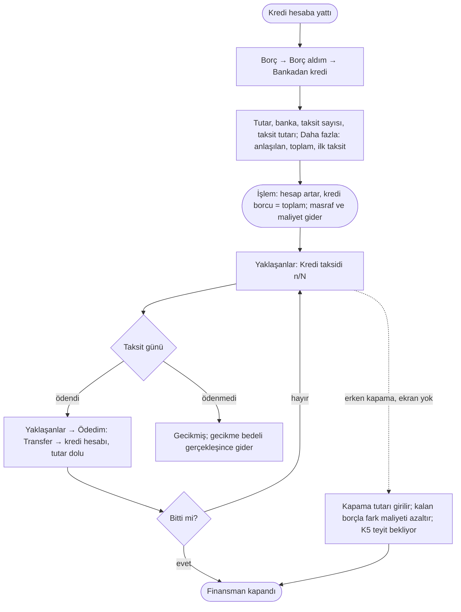

# AKS-009 — Kredi kullanmak (ihtiyaç finansmanı, yapılandırma)

- **Durum:** İşlem kuralı **karar** ([ROADMAP](../../ROADMAP.md), 2026-10-07) ve **uygulandı**: Borç → Borç aldım → "Bankadan kredi". Banka davranışı (erken kapama, masraflar) hâlâ **varsayımsal**; ürün sahibi gerçek akışı anlatmadı.
- **Kaynak:** Anlatım 1 (senaryo 8), Anlatım 5, karar Anlatım 7 (ilk sürümde VAR), araştırma Anlatım 8
- **Kim:** Ben
- **Tetikleyici:** Banka kredi/finansman verdi (para hesabıma yattı) ya da borcum yapılandırıldı
- **Sıklık:** Son zamanlarda sık
- **Hedef:** (anlatılacak) Kalan borç, taksit takvimi, toplam maliyet görmek

## Araştırma bulguları ve varsayımlar (Anlatım 8)
Her satır "varsayım" etiketlidir. Kaynak: Türkiye Finans Bankacılık İşlemleri Sözleşmesi Bireysel (madde 4.9, 5, 6), ihtiyaç finansmanı sayfaları, hesapkurdu/teklifimgelsin/hesap.com karşılaştırma sayfaları.

| # | Varsayım | Güven |
|---|---|---|
| K1 | Katılım bankasında ürün **faiz değil kâr payıdır.** İhtiyaç finansmanı **murabaha**: banka ürünü peşin alıp vadeli satar, fiyat farkı = kâr payı. | Orta (genel ürün tanımı) |
| K2 | **Toplam geri ödeme sözleşmede baştan sabit.** Değişken faiz yok; taksitler sabit, genelde aylık. Önceki taslaktaki "KMH / değişken faiz / oran değişimi" satırları **bu ürün için geçersiz olabilir.** | Orta, doğrulanmadı |
| K3 | Masraflar: **tahsis ücreti, sigorta (hayat/ferdi kaza), KKDF ve BSMV.** Tahsis ücreti/sigorta kredi tutarından **düşülebilir** (net ele geçen < anlaşma tutarı) veya **ayrı ödenir.** | Düşük-orta |
| K4 | Örnek oranlar (aylık ~%3,9-5,8, 12-36 ay) karşılaştırma sitelerinden; **güvenilmez, kesin kabul edilmesin.** Kullanıcı kendi sözleşmesindeki tutarları girer; uygulama oran varsaymaz. | Düşük |
| K5 | **Erken kapama masrafı/tazminatı: BULUNAMADI.** Yalnız karz yöntemi formunda "erken ödemede kâr payı erken ödeme tarihine göre hesaplanır" (kâr payı indirimi) ifadesi var. Murabaha ihtiyaç finansmanında geçerli mi: bilinmiyor. | **Ürün sahibi teyit etsin** |

## İşlem kuralı [karar] [uygulandı]
- **Kredi günü:** hesaba yatan tutar + **toplam geri ödeme** borcu (kredi hesabı kendiliğinden açılır: "&lt;banka adı&gt; kredisi").
  - anlaşılan − yatan = **Kredi Masrafı** gideri (tahsis, sigorta).
  - toplam − anlaşılan = **Kredi Maliyeti** gideri (kâr payı / faiz), o gün.
- **Kullanıcı girer:** hesaba yatan tutar, banka, taksit sayısı, taksit tutarı. "Daha fazla": anlaşılan tutar, toplam geri ödeme, ilk taksit tarihi. Boşsa: anlaşılan = yatan, toplam = sayı × tutar, ilk taksit bir ay sonra.
- Form "Toplam geri ödeme X · maliyet Y" özetini gösterir.
- **Taksit takvimi:** gösterim; Yaklaşanlar'da "Kredi taksidi n/N".
- **Her taksit ödemesi:** Transfer → kredi hesabı, tek tutar; bölüm (anapara/kâr payı) yok.
- **Erken kapama indirimi:** Fark; maliyeti azaltır [karar]. Ekran **yok** (harita B9).

## Akış

## İstisnalar / sapmalar (matris)
| Durum | Not |
|---|---|
| **Kâr payı / tahsis / sigorta / KKDF-BSMV** | Kredi günü gider (Kredi Maliyeti / Kredi Masrafı). Sabit takvimde toplam baştan bilinir (K2). |
| **Net ele geçen ≠ anlaşılan tutar** (K3) | "Daha fazla → Anlaşılan tutar"; fark Kredi Masrafı. Sigorta/tahsis ayrı ödendiyse ayrı Gider. |
| **Taksitli geri ödeme** | Normal akış; sabit taksit, takvim gösterim. |
| **Erken kapama** | Kalan borç + (varsa) masraf; kâr payı indirimi olabilir (K5 teyit bekliyor). Gerçek ödenen esas; fark "banka indirimi" düzeltmesi ([AKS-007](AKS-007-taksitli-alisveris.md) ile aynı kalıp). |
| **Kısmi erken ödeme** | Borç azalır; takvim yeniden hesaplanır mı (bankanın yeni takvimi esas); murabaha'da var mı bilinmiyor. |
| **Gecikme** | Gecikme bedeli gider; Yaklaşanlar'da "gecikmiş". Katılım bankasında gecikme için faiz değil farklı adlandırma olabilir (bilinmiyor). |
| **Kısmi ödeme** (taksiti eksik ödedi) | Kalan taksit devreder; takvim bankaya göre. |
| **Kredi iptali (cayma)** | Hesaba yatan para geri ödenir, masraflar iade/gider: ters işlem. |
| **Yapılandırma** | Eski borç kapanır, yeni takvim açılır; fark gerçekleşen tutardan. |
| **KMH (ek hesap)** | Ayrı ürün; eksi bakiye. Bu üründen ayrı tutulur; katılım bankasında nasıl işlediği bilinmiyor, öncelik düşük. |
| **Değişken faiz / oran değişimi** | K2'ye göre ihtiyaç finansmanında **yok**; yalnız farklı kredi türlerinde. Varsayılan akıştan çıkarıldı. |
| **Yabancı para kredisi** | Öncelik düşük. |
| **Başkası adına/ortak kredi** | Paylı borç: [AKS-004](AKS-004-hesap-bolusme.md) benzeri; soru. |
| **Yanlış girdim** | Geri Al ya da Sil + yeniden gir; kredi düzeltilemez. Taksit ödemesi girildiyse kredi silinemez; önce ödemeler silinir (açık soru). |

## Sürtünme & duygu
Henüz anlatılmadı. Varsayım: kullanıcı için asıl kaygı "net ele geçen ile toplam geri ödeme farkı" ve "her ay ne kadar çıkacak"; baştan sabit olması (K2) belirsizliği azaltır.

## Uygulamadaki karşılığı (şimdi)
- Yukarıdaki işlem kuralı uygulandı. Banka Rehber'de **marka** olarak açılır.
- Kredi işlemi silinirse kredi hesabı da kalkar; taksit ödemesi varsa silinemez.
- Kredi formunda etiket yok.
- Başlangıç sihirbazında girilen krediye takvim yok ([AKS-019](AKS-019-baslangic.md), harita B5).
- Erken kapama, kısmi erken ödeme, gecikme bedeli, yapılandırma, cayma için ekran yok. Gecikme bedeli bugün sıradan Gider olarak girilir.

## Notlar / açık sorular
[acik-sorular](../acik-sorular.md) (Nakit avans ve kredi; "Ürün sahibinin teyit edeceği banka bilgileri"; terim kararı; vade farkı).
