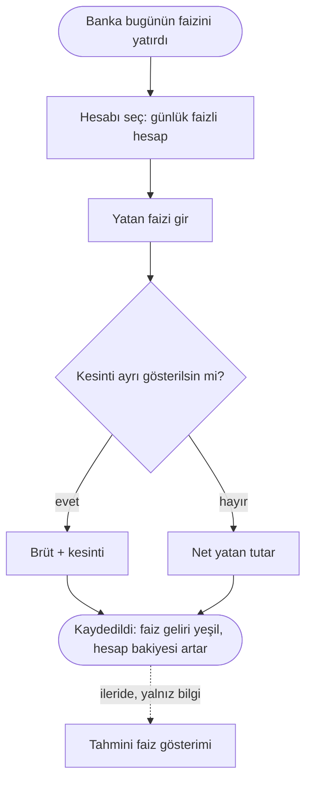

# AKS-010 — Günlük faizli hesap

- **Kaynak:** Anlatım 1 (senaryo 9), Anlatım 5, karar Anlatım 6
- **Kim:** Hesap sahibi (ben)
- **Tetikleyici:** Banka günlük faiz yatırdı (bildirim/hesap hareketi)
- **Sıklık:** Günlük (faiz her gün yatar)
- **Hedef:** Faiz gelirimi ve kesintileri (stopaj vb.) görmek; hesabın gerçek bakiyesiyle uyum

## Kararlar (Anlatım 6)
- Günlük faiz kaydı **elle girilir**.
- **İşlem esas alınır**: bankadan gerçekten yatan faiz kaydedilir. **Tahmini kayıt girilmez.**
- İleride belki **tahmini hesaplama gösterilebilir** (kayıt olarak değil, yalnız bilgi).
- Vergi/kesinti görünür olmalı (Anlatım 5).

## Akış

## İstisnalar / sapmalar
- Birkaç gün girilmezse birikim olur; toplu giriş istenebilir (soru açık).
- Bakiye ve oran değişince faiz değişir; tahmin ancak gösterim olarak anlamlı, kayıt olarak değil.

## Sürtünme & duygu
- **Her gün elle giriş** (Anlatım 7 çerçevesi): kullanıcılar zaten her gün kayıt girmek zorunda, aksi halde muhasebenin anlamı yok; ileride entegrasyon gelecek. Bu yüzden "üşengeç kullanıcı için yük" eleştirisi geri çekildi. Toplu giriş zorunlu değil, atlanan gün için yine de kullanışlı olabilir (öncelik düşük). Akışın kısa olması (tutar + hesap; gerisi türetilir) hâlâ iyi.
- Tahmin kayda girmediği için bakiye bankayla uyumlu kalır (güven).

## Uygulamadaki karşılığı (şimdi)
Faiz geliri için özel akış yok; genel gelir kaydı kullanılabilir. Hesap türü "günlük faizli" ayrımı (kesinti alanı) modelde ayrı bir şey mi, kontrol edilecek.

## Notlar / açık sorular
Bkz. [acik-sorular](../acik-sorular.md) (Faizli hesaplar). Vadeli tür: [AKS-018](AKS-018-vadeli-hesap.md).
