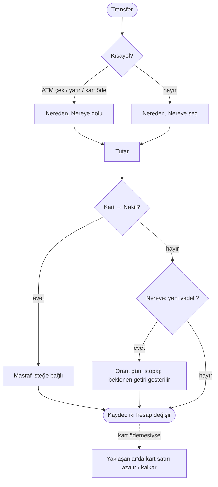

# AKS-012 — Transfer: hesaplar arası, ATM, kart ödemesi

- **Kaynak:** Anlatım 1 (ATM, transfer), Anlatım 8 (cüzdan otomatik), [ROADMAP](../../ROADMAP.md) kararları (kart ödemesi = Transfer → kart). Uygulama: Hızlı işlem v3 (2026-10-08). **AKS-002 (ATM çekme) ve AKS-003 (ATM yatırma) bu akışla birleşti.**
- **Kim:** Her kullanıcı (yalnız kendi hesapları arasında)
- **Tetikleyici:** Para kendi hesaplarım arasında yer değiştirdi
- **Sıklık:** ATM orta; kart ödemesi ayda bir kart başına; diğerleri orta
- **Hedef:** Bakiyeler bankayla aynı kalsın; gelir/gider oluşmasın

## Kural
Transfer gelir ya da gider değildir. Hedef ya da kaynak türüne göre uygulama olayın adını kendisi bilir:

| Nereden → Nereye | Uygulamanın adı | Ek alan |
|---|---|---|
| Banka → Nakit | ATM'den çektim (kısayol) | — |
| Nakit → Banka | ATM'ye yatırdım (kısayol) | — |
| Banka → Kredi kartı | Kart borcu ödedim (kısayol) | — |
| Kredi kartı → Nakit | Nakit avans ([AKS-008](AKS-008-nakit-avans.md)) | Masraf (isteğe bağlı) |
| Banka → "+ Yeni vadeli hesap" | Vadeli açılış ([AKS-018](AKS-018-vadeli-hesap.md)) | Yıllık oran, gün, stopaj |
| Banka → Kredi hesabı | Kredi taksidi ([AKS-009](AKS-009-kredi.md)) | — |

Kısayol çipi Nereden/Nereye'yi doldurur. Türün tek hesabı varsa o seçilir; birden çoksa kullanıcı seçer. Nakit hesabı yoksa sunucu açar.

## Akış

## İstisnalar
| Durum | Kalıp | Not |
|---|---|---|
| Yanlış hesap seçtim | Geri Al / Sil | Transfer bugün düzeltilemez; sil ve yeniden gir. |
| ATM'den para çıkmadı, banka iade etti | İade | İade akışı yok; bugün işlem silinir. |
| Kart borcunun bir kısmını ödedim | Kısmi | Kalan Yaklaşanlar'da kalır. |
| Kart borcundan fazla ödedim | — | Kart artıya geçer; uyarı yok (açık soru). |
| Karttan banka hesabına para | Fark (masraf) | Bugün sıradan transfer; nakit avans sayılmıyor (açık soru, harita B8). |
| Başka banka ATM masrafı | Fark | ⏸ Ertelendi. |
| Yabancı para hesaplar arası | — | Transfer yalnız ana para birimi; döviz "Diğer → Döviz al/sat". |
| Başka üyenin hesabına para | — | Transfer değil: verende gider, alanda gelir (karar, harçlık). |

## Sürtünme
- ATM ilk ekrandan kalktı: Transfer + kısayol = iki dokunuş (harita B12).
- Kart ödemesinde tutar Yaklaşanlar'dan dolu gelir; taksitli alışveriş varsa yanlış tutar gelir (harita B2).

## Uygulamadaki karşılığı (şimdi)
Hızlı işlem → Transfer: kısayol çipleri, tutar, Nereden → Nereye, tarih, Daha fazla (etiket). Altta "Diğer: Döviz al / sat · Yatırım" bağlantıları. Listede banka ↔ nakit "ATM" olarak, diğerleri "Transfer" olarak görünür.

## Açık sorular
[acik-sorular](../acik-sorular.md) (Transfer, ATM, nakit).
