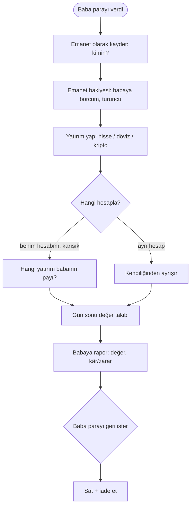

# AKS-015 — Emanet parayla yatırım (ÇOK ZOR)

- **Kaynak:** Anlatım 1
- **Kim:** Ben (yönetici) + baba (para sahibi, yatırımdan anlamıyor)
- **Tetikleyici:** Baba parayı verir; ben onun adına yatırım yaparım
- **Sıklık:** Sürekli; günlük takip, periyodik rapor
- **Hedef:** Para babamın ama benim hesaplarımda görünüyor. Babamın varlığını **benim net varlığımdan ayırmak**, yine de aynı yatırım hesaplarında yönetmek ve ona rapor vermek.

## Akış (ilk taslak, doğrulanmadı)

## Netleşenler (Anlatım 2)
- Baba **kullanıcı değil**; sadece günlük/aylık kâr/zarar bilgisi alır (pasif alıcı).
- Emanet para kendi yatırımlarla **karışık** durur → hesap bazında ayırma mümkün değil.
- Sonuç: ayrım ancak **pay mantığıyla** yapılabilir (emanet = toplam portföyün belirli bir payı; kâr/zarar bu paya orantılı). Fon payı (birim) yaklaşımı aday; **henüz karar yok**.

- Para **sürekli giriyor ve çıkıyor** → pay mantığı zorunlu (basit "giren − değer" farkı yanlış kâr verir).
- Bugün kâr/zarar **aracı kurum uygulamalarından elle** hesaplanıyor; uygulamanın değeri bu manuel işi ortadan kaldırmak.
- Mental model: **fon yönetimi** (birim değeri, giriş/çıkışta pay alma/bozma, dönemsel getiri).

## Karar (Anlatım 6, dolaylı)
- Mevcut kişiler **Rehber ile birleşiyor**; baba Rehber'de **bireysel kişi** olarak durur (ayrı "emanet sahibi" nesnesi gerekmez, yalnız o kişiye bağlı emanet/pay kaydı). Emanet akışının kendisi için yeni karar yok; sorular açık.

## Çatışmalar
- Net varlık (mavi) emanet parayı **saymamalı**, ama nakit/yatırım bakiyeleri saymalı.
- Mevcut model: "Her kayıt tek üyeye aittir"; baba üye mi, kişi mi?
- Kâr/zarar kime ait? Komisyon/ücret var mı?
- Rapor babaya nasıl gider? Baba uygulamada yok → ekran görüntüsü / paylaşılabilir özet (metin veya görsel) olabilir; format sorusu açık.
- Karışık portföyde babanın payı para girişi/çıkışında değişir; kâr/zarar payı zamana göre hesaplanmalı (ör. 100 bin girişten sonra yatırım değeri değişti, sonra 50 bin daha girdi).

## Açık sorular
Bkz. [acik-sorular](../acik-sorular.md) (Emanet para bölümü).
