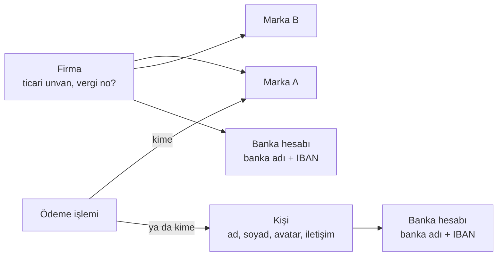
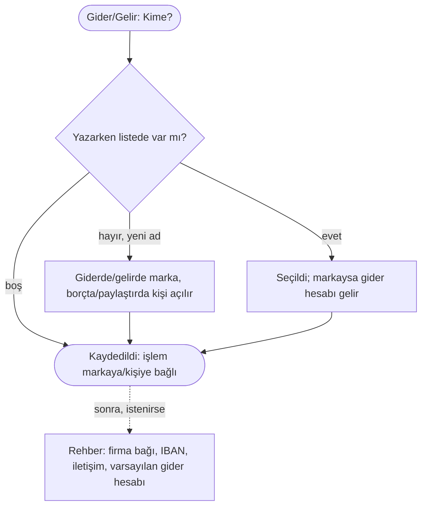

# AKS-016 — "Kime ödeme yaptım?" (kişi / firma / marka)

- **Kaynak:** Anlatım 4-8; uygulama 2026-10-07 (Rehber)
- **Kim:** Her kullanıcı
- **Tetikleyici:** Harcama işlemi ([AKS-001](AKS-001-kartla-alisveris.md)), bölüşme, borç, havale... para ödenen ya da alınan her olay
- **Sıklık:** Her gider işleminde
- **Hedef:** Para kime gitti sorusuna **marka** diliyle cevap (X). Sistem arkada **ticari unvanı** (firmayı) bilir; ekstre/fiş eşleşmesi unvan üzerinden yapılabilir.

## Nesne ilişkisi

## Akış (işlem anı)

## Kararlar
- Üç tür (kişi / firma / marka) ve Rehber sayfası v1'de [karar] [uygulandı]. İşlem anında firma sorulmaz [karar].
- Gider hesabı markadan gelir; işlemde değiştirilebilir; yalnız o işlem değişir [karar] [uygulandı].
- Eski "kişiler" Rehber'e katıldı [uygulandı].
- ⏸ ATM başka banka masrafı.

## Raporlama (hedef; uygulanmadı)
- Varsayılan görünüm: **marka** ("Migros'a ne kadar ödedim").
- İsteğe bağlı üst görünüm: **firma** (aynı unvana giden toplam).
- Ekstre/fiş teyidi: unvan ile firma eşleşir, marka oradan bulunur.

## Sürtünme
- Her harcamada "kime" sorusu zahmetli; işlem girerken **yazarken öner**, son/sık kullanılanlar üstte; boş geçilebilir.
- Marka/firma/kişi ayrıntısı (IBAN, iletişim) işlem anında istenmemeli; sonradan Rehber sayfasında tamamlanır.

## Uygulamadaki karşılığı (şimdi) [uygulandı]
- **Rehber sayfası:** arama; süzgeç Tümü · Kişi · Marka · Firma; kişide borç bakiyesi (iki yön). Rehber formu: ad (firmada "ticari unvan"), tür; markada varsayılan gider hesabı; "Ayrıntılar" altında marka ↔ firma bağı (çoka çok), telefon, e-posta, vergi no (firma), IBAN listesi (kopyala düğmesi). Kişi ve firmada IBAN var, markada yok. "Rehber'den kaldır".
- **İşlem anında:** "Kime ödedin?" / "Kimden aldın?" yazarken öneri listesi. Firma hiç sorulmaz. Yeni ad giderde/gelirde marka, borçta/paylaştırda kişi olarak açılır.
- **Gider hesabı:** marka yazılınca varsayılan gider hesabı gelir; kullanıcı değiştirirse yalnız o işlem değişir. Markanın varsayılanı yoksa ilk kullanılan gider hesabı varsayılan olur. Şablonda yaygın markalar varsayılan gider hesaplarıyla hazır gelir.
- **Firma belirsizliği:** işlem markaya bağlanır; firma işlemde tutulmaz. Marka birden çok firmaya bağlıysa işlemin firması belirsiz kalır. Anlatım 6'daki "işlemde firma seçilebilir" kararından sapma; onay bekliyor ([acik-sorular](../acik-sorular.md), Rehber).
- **Rapor:** marka/firma bazlı rapor **yok**.

## Uygulamaya bakarak boşluklar
| Durum | Bugün | Öneri |
|---|---|---|
| Yazım hatası ("Migroz") | Yeni marka açılır | Rehber'de "Birleştir" (harita B10) |
| Bakiyesi olan kişi Rehber'den kaldırıldı | Kontrol yok | Önce uyar |
| Marka sonradan kişi olmalıydı (tür yanlış) | Rehber'den tür değişir | — |
| Aynı ad iki farklı kişi (iki "Ahmet") | Ad eşleşmesi ilk bulunanı seçer | Rehber'de ad ayırt edici olmalı; öneri yok, sık değil |

## Açık sorular
Bkz. [acik-sorular](../acik-sorular.md) (Rehber bölümü).
