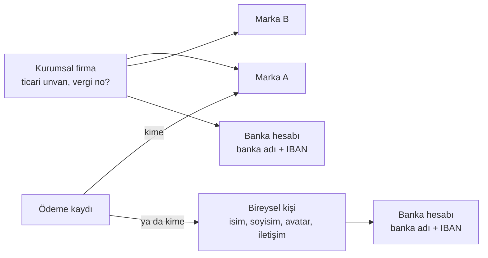
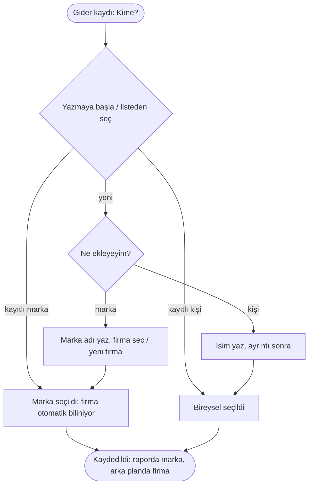
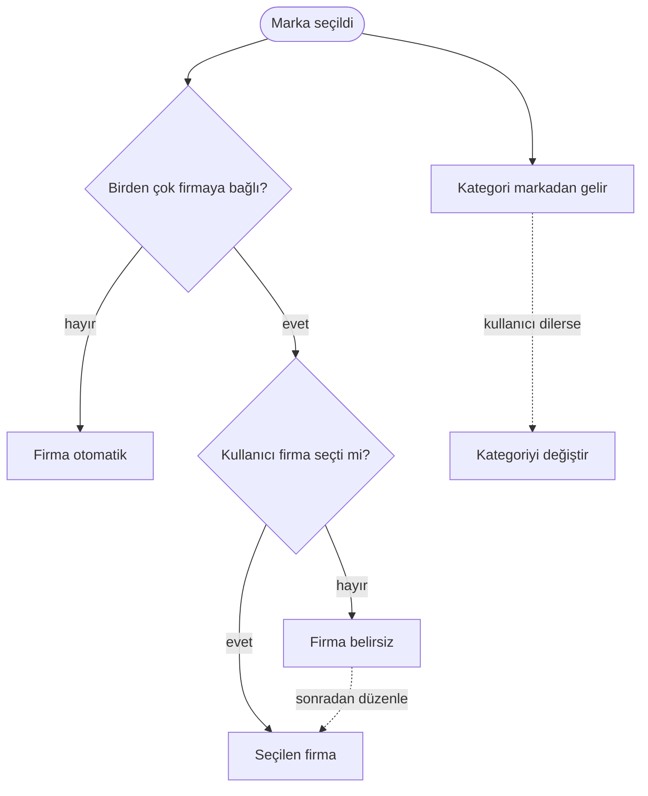

# AKS-016 — "Kime ödeme yaptım?" (kişi / kurum / marka)

- **Kaynak:** Anlatım 4
- **Kim:** Her kullanıcı
- **Tetikleyici:** Harcama kaydı ([AKS-001](AKS-001-kartla-alisveris.md)), bölüşme, borç, havale... ödeme/alacak olan her olay
- **Sıklık:** Her gider kaydında
- **Hedef:** Para kime gitti sorusuna **marka** diliyle cevap (X). Sistem arka planda **ticari unvanı** (firmayı) bilir; ekstre/fiş eşleşmesi unvan üzerinden yapılabilir.

## Nesne ilişkisi

## Akış (kayıt anı)

## Kararlar (Anlatım 6)
- **Firma belirsiz kalabilir:** Marka birden çok firmaya bağlıysa kayıt anında kullanıcı firmayı **seçebilir**; seçmezse **belirsiz** kalır. Kayıt sonradan **düzenlenebilir** (firma sonradan seçilir).
- **Kategori:** Marka üzerinden otomatik gelir; aynı markanın farklı kategorileri olabilir, kullanıcı kayıtta **değiştirebilir**.
- **Rehber birleşmesi:** Mevcut "kişiler" (borç/alacak) Rehber ile **tek yer** olur. Bireysel kişiler, firmalar ve markalar aynı Rehber'dedir.
- Ertelendi (kapsam dışı değil, bilinçli bekletildi): ATM başka banka komisyonu masrafı; varsayılan kategoriler/hesaplar tamamlanana kadar dokunulmayacak.

## Karar (Anlatım 8)
Üç katman (kişi / firma / marka) ve Rehber sayfası **v1'de VAR** (ürün sahibi kararı; "tek kayıt" eleştirisi karşılanmadı). Sade sunum önerileri (kullanıcı marka yazar, firma arka planda/boş, firma Rehber'de ayrıntı altında, tek liste + tür filtresi): [analiz](../arsiv/analiz.md) Anlatım 8. Kayıt anında firma sorusu önerilmez (doğrulanmadı).

## Raporlama
- Varsayılan görünüm: **marka** ("Migros'a ne kadar ödedim").
- İsteğe bağlı üst görünüm: **firma** (aynı unvana giden toplam).
- Ekstre/fiş teyidi: unvan ile firma eşleşir, marka oradan bulunur.

## Sürtünme
- Her harcamada "kime" sorusu zahmetli; kayıt sırasında **yazarken öner**, son/sık kullanılanlar üstte; boş geçilebilir.
- Marka/firma/kişi ayrıntısı (IBAN, iletişim) kayıt anında istenmemeli; sonradan Rehber sayfasında tamamlanır.

## Uygulamadaki karşılığı
`contacts` ve People sayfası var (borç/alacak odaklı). Marka–firma ilişkisi ve banka hesapları **yok**; kurumlar kişi ile aynı nesne mi, kontrol edilecek.

## Açık sorular
Bkz. [acik-sorular](../acik-sorular.md) (Rehber bölümü).
