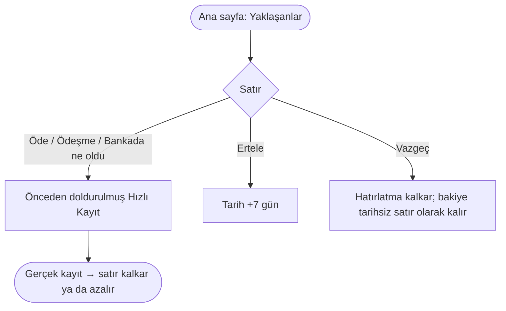

# AKS-017 — Yaklaşanlar / hatırlatma

- **Kaynak:** Anlatım 6-7; uygulama 2026-10-07 (Plan ve Yaklaşanlar)
- **Kim:** Ben; karşı taraf kişi, kart, banka ya da vadeli hesap
- **Tetikleyici:** Tarihli ya da açık bir şey bekliyor: kart son ödeme, kredi taksidi, vade günü, borç/alacak
- **Sıklık:** Uygulama her açıldığında görülür
- **Hedef:** Unutmamak; gerçek kayıt girilince satır kendiliğinden kalksın

## Kararlar [uygulandı]
- Yalnız uygulama içi liste, **Ana sayfada** "Yaklaşanlar" kartı. Telefon bildirimi yok. Kişiye mesaj yok.
- Hepsi **gösterim**, kayıt değil.
- Sıra: tarihe göre; geçmiş tarih kırmızı "Gecikmiş" (vadeli hesapta "Bekliyor"); tarihsiz satırlar en altta.
- Liste yalnız giren üyenin kendi kartlarını, kredilerini, vadelilerini ve kişi bakiyelerini gösterir.

| Satır | Ne zaman görünür | Tutar | Düğme | Kendiliğinden kalkar |
|---|---|---|---|---|
| Kart son ödeme | Kartta kesim ve son ödeme günü girildiyse, kalan > 0 | Kesimdeki borç − kesimden sonra ödenen | Öde → Transfer, kart ve tutar dolu | Kart ödemesi kalanı sıfırlayınca |
| Kredi taksidi n/N | Kalan borç > 0 | Taksit tutarı | Öde → Transfer → kredi hesabı | Bütün taksitler ödenince |
| Vade günü | Vadeli hesap açıkken | Anapara + beklenen getiri | Bankada ne oldu? ([AKS-018](AKS-018-vadeli-hesap.md)) | Vade sonu kaydı girilince |
| Borç/alacak (tarihli) | Vade tarihi girildiyse | Kişiyle net bakiye | Ödeşme · Ertele (+7 gün) · Vazgeç | Bakiye 0 olunca |
| Borç/alacak (tarihsiz) | Bakiye ≠ 0 | Kişiyle net bakiye | Ödeşme | Bakiye 0 olunca |

## Akış

## İstisnalar
| Durum | Kalıp | Bugün |
|---|---|---|
| Kısmi ödeme | Kısmi | Kalan tutarla listede kalır |
| Kart taksitli alışveriş içeriyor | — | Tutar taksitlerin tamamını içerir (harita B2) |
| Kartta kesim/son ödeme günü yok | — | Kart listede hiç görünmez |
| Borçtan vazgeçtim (bağış) | Kapanış | Vazgeç bakiyeyi kapatmaz (harita B4) |
| Vade günü hafta sonu, para gelmedi | — | "Bekliyor"; kayıt girilene kadar kalır |
| Taksit takvimi | — | Listede yok; Ayarlar → Taksitler (harita B6) |
| Ödenmiş ama girilmemiş | — | Kayıt girilene kadar kalır (kayıt = gerçekleşen) |

## Sürtünme
- Liste yalnız uygulama açılınca görünür; bilinçli sınır.
- Arkadaşa para sormak zahmetli; liste sessizce hatırlatır.

## Açık sorular
[acik-sorular](../acik-sorular.md) (Yaklaşanlar).
