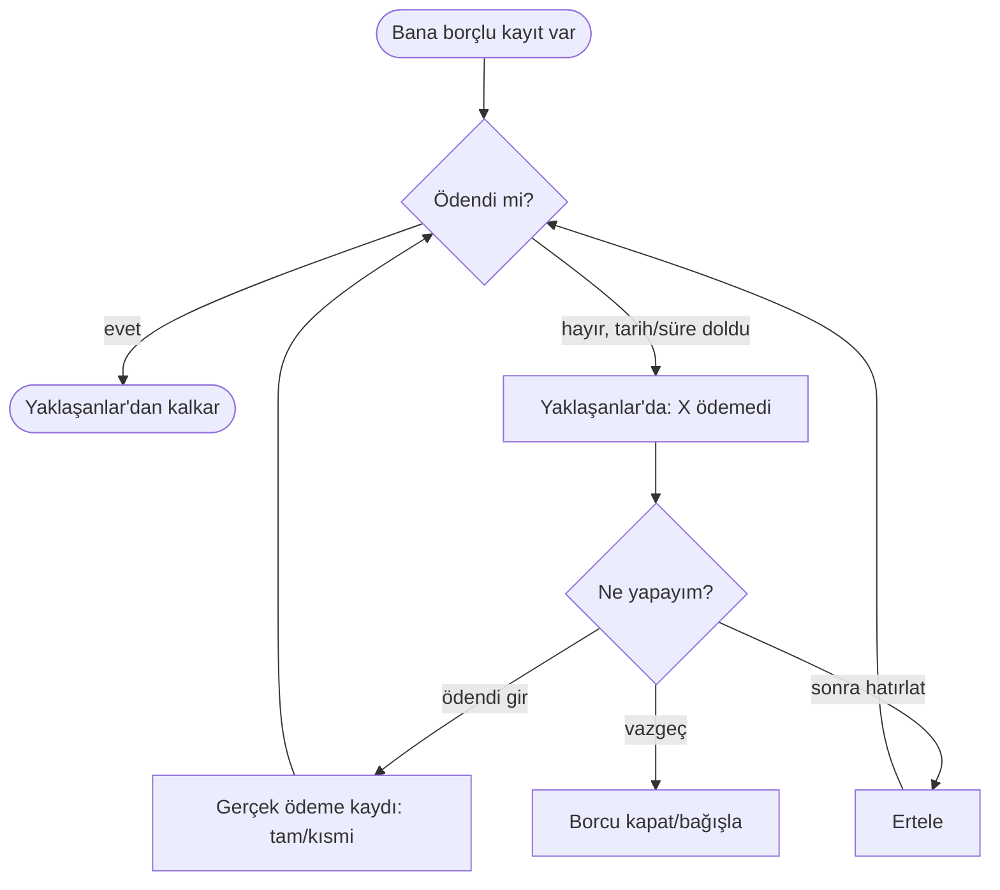

# AKS-017 — Yaklaşanlar / hatırlatma ("kişi/kurum ödemedi")

- **Kaynak:** Anlatım 6; **güncellendi: Anlatım 7 (yalnız uygulama içi liste)**
- **Kim:** Ben (alacaklı); borçlu bir kişi veya kurum
- **Tetikleyici:** Birinin bana borcu var (bölüşme [AKS-004](AKS-004-hesap-bolusme.md), borç verme AKS-006) ve ödemedi
- **Sıklık:** Düşük-orta; borç bekleyen her kayıt için
- **Hedef:** Unutmadan alacağımı takip etmek; ödeyince kayıt kendiliğinden kapanmalı

## Karar (Anlatım 7)
**Bildirim yalnız uygulama içi liste: "Yaklaşanlar".** Native/telefon bildirimi **yok**. Kullanıcı uygulamayı açtığında listeyi görür. Bu ekran aynı zamanda ekstre taksit takvimi ([AKS-007](AKS-007-taksitli-alisveris.md)), vade günü ([AKS-018](AKS-018-vadeli-hesap.md)), kredi taksit takvimi ([AKS-009](AKS-009-kredi.md)) ve borç vadesini gösterir. Hepsi **kayıt değil, gösterim/hatırlatma**.

## Akış

## İstisnalar
- Kısmi ödeme: kalan tutar için listede kalır.
- Kişi ödeyince (ödeme kaydı girildiğinde) satır otomatik kapanır; yanlış alarm olursa "ödendi" ile kapatılır.
- Kurum: bana borçlu kurum (iade, alacak) olabilir; "ben kuruma ödemedim" (fatura) ayrı konu, fatura/abonelik **sonraki aşamada**.
- Kişiye mesaj gitmesi: uygulama dışı; bu sürümde yok.

## Sürtünme & duygu
- Arkadaşa para sormak sosyal olarak zahmetli; liste sessizce hatırlatır, kimseyi rahatsız etmez.
- Liste yalnız uygulama açılınca görünür; kullanıcı açmazsa kaçırır. Bu bilinçli kabul edilen sınır.

## Uygulamadaki karşılığı (şimdi)
Yaklaşanlar listesi yok; `contact_balances` bakiyeyi gösteriyor. Vade/tarih alanı borç kaydında yok olabilir (kontrol edilecek, **uyumsuzluk adayı**).

## Notlar / açık sorular
Bkz. [acik-sorular](../acik-sorular.md) (Hatırlatma / Yaklaşanlar). Vade günü için bkz. [AKS-018](AKS-018-vadeli-hesap.md).
