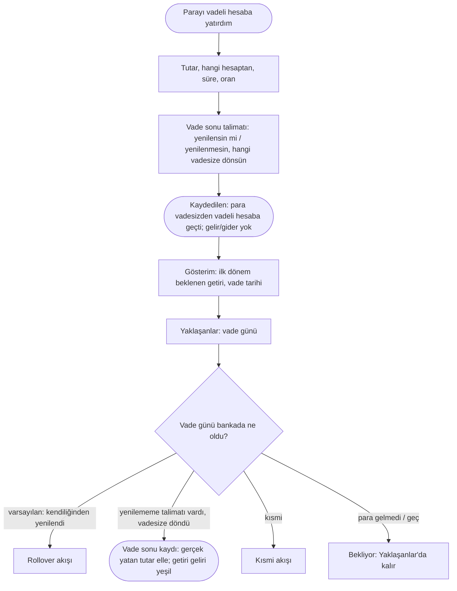
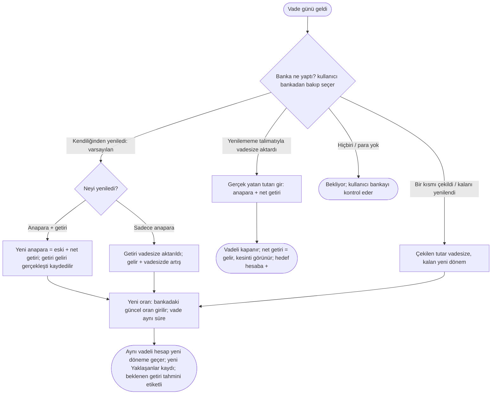
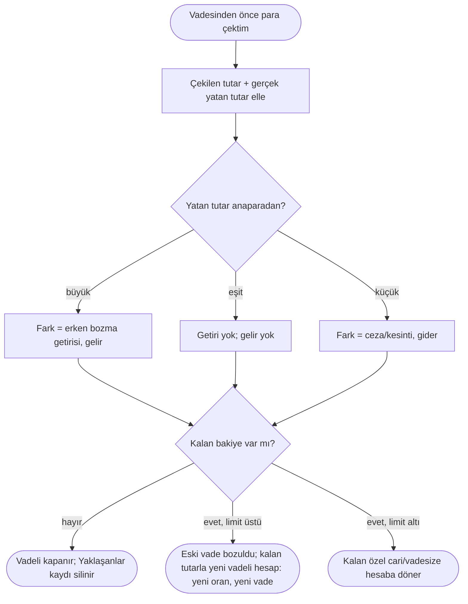

# AKS-018 — Vadeli hesap (30-90 gün): açılış, vade sonu, yenileme, erken bozma

- **Kaynak:** Anlatım 1 (senaryo 9), Anlatım 5, kararlar Anlatım 6; genişletildi Anlatım 7; **düzeltildi: Anlatım 8 (2026-10-07, Türkiye Finans katılma hesabı araştırması)**
- **Kim:** Hesap sahibi (ben)
- **Tetikleyici:** Parayı belli süreliğine, sabit oranla vadeli hesaba yatırdım
- **Sıklık:** Nadir açılış; vade sonu tek olay (yenileme varsa tekrarlar)
- **Hedef:** Vade sonunda ne kadar alacağımı bilmek (bugün Excel'le hesaplanıyor), vade gününü unutmamak, parayı doğru hesapta görmek

## Düzeltme (Anlatım 8): varsayılan sonuç artık "yenileme"
Önceki sürümde "vade bitince vadesize döner" varsayılan kabul edilmişti (Anlatım 6). Türkiye Finans katılma hesabı sözleşmesine göre (**varsayım, doğrulanmadı**; kaynak: Bankacılık İşlemleri Sözleşmesi Bireysel, madde 4.9/5/6 ve ön bilgilendirme formları, turkiyefinans.com.tr) hesap, yenilememe yazılı bildirilmezse vade bitiminden itibaren **aynı süreyle kendiliğinden uzar**. Sonuç:
- **Varsayılan beklenti = yenileme.** "Vadesize döndü" ancak müşteri yenilememe talimatı verdiyse olur.
- **Yenilemede oran değişir:** yenileme tarihindeki güncel kâr payı oranı uygulanır. Yani yenilenen dönemin beklenen getirisi **önceden bilinemez**; ilk dönemin beklenen getirisi (sabit, sözleşmeden) yalnız ilk dönem için doğrudur.
- **Kayıt = gerçekleşen:** uygulama "yenilendi" varsaymaz ve kendiliğinden kayıt yazmaz. Vade günü kullanıcı bankadan gerçeği görür ve elle kaydeder (yenilendi / vadesize döndü / kısmi).
- Önceki "hedef hesap" kararı (Anlatım 6) **yenilememe senaryosuna bağlandı**: hedef vadesiz hesap, "yenileme" talimatı verilmediyse devreye girer. Açılışta zorunlu bir alan olmaktan çıkar; "vade sonunda ne olsun: yenilensin / şu vadesize dönsün" tercihi bankadaki talimatın yansımasıdır (kaydedilirse Yaklaşanlar metni ona göre yazılır).
- Terim: katılım bankasında "faiz" değil "kâr payı" (bkz. [acik-sorular](../acik-sorular.md), terim kararı).

## Kararlar
- (Anlatım 6) **Beklenen getiri gösterilir** ("vade sonunda ~X TL alacaksın"); gösterimdir, kayıt değil. **Anlatım 8 kaydı:** yalnız ilk dönem için kesin; yenilemeden sonrası için "tahmini, oran değişebilir" etiketi.
- (Anlatım 6) Hangi vadesize hesaba döneceğini kullanıcı seçer (yenilememe senaryosunda, yukarıya bakın).
- (Anlatım 7) Bildirim yalnız uygulama içi liste ("Yaklaşanlar"). Telefon/native bildirimi yok. Vade günü görünür, geçerse "bekliyor" kalır.
- (Anlatım 7) Gerçekleşen esas: kâr payı/faiz geliri banka yatırınca (veya yenileme/bozmada gerçekleşince) kaydedilir; açılışta kaydedilmez.
- (Anlatım 7) Otomatik yenileme, rollover ve erken bozma kapsamda.

## Akış 1: açılış → vade sonu

## Akış 2: vade sonu sonuçları

## Akış 3: erken bozma
Anlatım 8 araştırması (**varsayım, doğrulanmadı**): genel sözleşmede vadeden önce çekim yapılınca hesabın **tamamı** için vade bozulmuş sayılır; kalan bakiye **yeni bir katılma hesabına** dönüşür. Yani "kısmi bozma" = tam bozma + kalan tutarla yeniden açılış. Kalan bakiye en düşük limitin altındaysa özel cari hesaba döner. Erken bozmada kâr payı ödenir mi / ne kadar: **bulunamadı, ürün sahibi teyit etmeli.**

## İstisnalar / sapmalar (tüm ihtimaller)
| Durum | Ne olur |
|---|---|
| **Kendiliğinden yenilendi (varsayılan, Anlatım 8)** | Kullanıcı vade günü bankadan bakıp "yenilendi" der; yeni oran girilir. Uygulama kendi başına yenilendi saymaz (kayıt = gerçekleşen). Kullanıcı hiç bakmazsa Yaklaşanlar'da "bekliyor" kalır. |
| **Yenilememe talimatıyla vadesize döndü** | Yaklaşanlar kaydı kapanır. Gerçek yatan tutar elle girilir (beklenen net öneri olarak gösterilir). |
| **Yenilendi, anapara+getiri** | Getiri gerçekleşti sayılır (gelir), yeni anapara büyür; vadesize hiç para gelmez. |
| **Yenilendi, yalnız anapara** | Getiri vadesize yatar (gelir + vadesiz artışı); vadeli bakiye aynı kalır. |
| **Yeni oran** | Yenilemede **güncel banka oranı** uygulanır; eski oranı öneri göstermek yanıltıcı (Anlatım 8: oran değişir). Öneri: "bankadaki yeni oranı gir"; eski oran yalnız bilgi. Vade süresi varsayılan = aynı süre. |
| **Banka oranı vade sonunda değiştirdi** | Beklenen getiri gösterimi yenilemeden sonra "tahmini"; gerçek getiri vade sonunda kaydedilir. |
| **Kısmi** | Bir kısmı vadesize çekildi, kalan yeni dönem: iki sonuç tek ekranda. |
| **Erken bozma, getiri kaybı** | Gerçek yatan tutar elle; fark gelir (azalmış getiri) ya da gider (ceza), uygulama farkı türetir. Banka kuralı teyit bekliyor. |
| **Erken bozma, anapara eksik yattı** | Yatan < anapara: fark gider (ceza/komisyon); yalnız kategori önerilir. |
| **Kısmi erken çekim** | Standart sözleşmede (varsayım) tam bozma + kalan yeni hesap. Kullanıcı iki şeyi girer: çekilen/gerçek yatan; kalan için yeni oran-vade. Kalan limit altındaysa vadesize/cari. |
| **Kur korumalı hesap** | Vadeden önce kısmi çekim yok; kapatma bankanın iznine bağlı; yenileme müşteri talebiyle (otomatik değil). Bu türde varsayılan sonuç "yenileme" değil. Önceliği düşük, ayrı tür mü soru. |
| **Hedef hesap kapalı** | Başka hesap seçilir; kapalı hesap seçenek olarak gösterilmez, geçmiş kayıtta kalır. |
| **Vade günü hafta sonu/tatil** | Para sonraki iş günü; "bekliyor". |
| **Para yatmadı / geç yattı** | "Bekliyor" olarak Yaklaşanlar'da kalır; kayıt yalnız yattığında. |
| **Stopaj / kesinti** | Beklenen getiri brüt mü net mi (açık); kayıtta net yatan esas, kesinti ayrı görünür. |
| **Beklenen ≠ gerçek** | Gerçek yatan tutar kayıttır; fark bilgi olarak kalabilir. |
| **Yabancı para vadeli** | Getiri ve anapara dövizle; TL karşılığı gerçekleşen kurla. Öncelik düşük. |
| **Yanlış girdim (oran, vade, tutar)** | Açılışı düzenle; gösterim ve Yaklaşanlar yeniden hesaplanır. Vade sonu kaydı yapıldıysa önce o düzeltilir. **Geri Al (ilk sürümde var, Anlatım 8)** son kaydı geri çeker. |
| **Hiç kapatmadım (unutuldu)** | Geçmiş vade "bekliyor" listede kalır; açıkta kalmaz. |

## Sürtünme & duygu
- Bugün Excel'le hesaplama zahmeti; beklenen getiri gösterimi doğrudan değer.
- **Yenileme sessiz olur**; kullanıcı fark etmeyebilir. Varsayılan davranış yenileme olduğu için "vade günü" kaydı kullanıcıdan *bankaya bakıp ne olduğunu girmesini* ister (uygulama içi; telefon bildirimi yok).
- Yenilemede oran değiştiği için beklenen getiri belirsizleşir; kullanıcı Excel'deki hesabın artık tutmayacağını görebilir. Etiketleme ("tahmini") bu hayal kırıklığını azaltır.
- Anapara+getiri mi yalnız anapara mı yenilendiğini kullanıcı bankadan bilir; yanlış seçilirse bakiye bankadan sapar.

## Uygulamadaki karşılığı (şimdi)
Vadeli hesap için özel nesne (vade tarihi, oran, hedef hesap, yenileme tercihi) yok; `accounts` tipleri kontrol edilecek, **uyumsuzluk adayı**. Yenileme "aynı hesap yeni dönem" olarak nasıl modelleneceği (dönem geçmişi) ayrıca bir uyumsuzluk adayı. Yaklaşanlar için tarih/Plan karşılığı yok (kod okunmadı).

## Notlar / açık sorular
Bkz. [acik-sorular](../acik-sorular.md) (Faizli hesaplar ve "Ürün sahibinin teyit edeceği banka bilgileri"). Günlük faizli tür: [AKS-010](AKS-010-gunluk-faizli-hesap.md).
