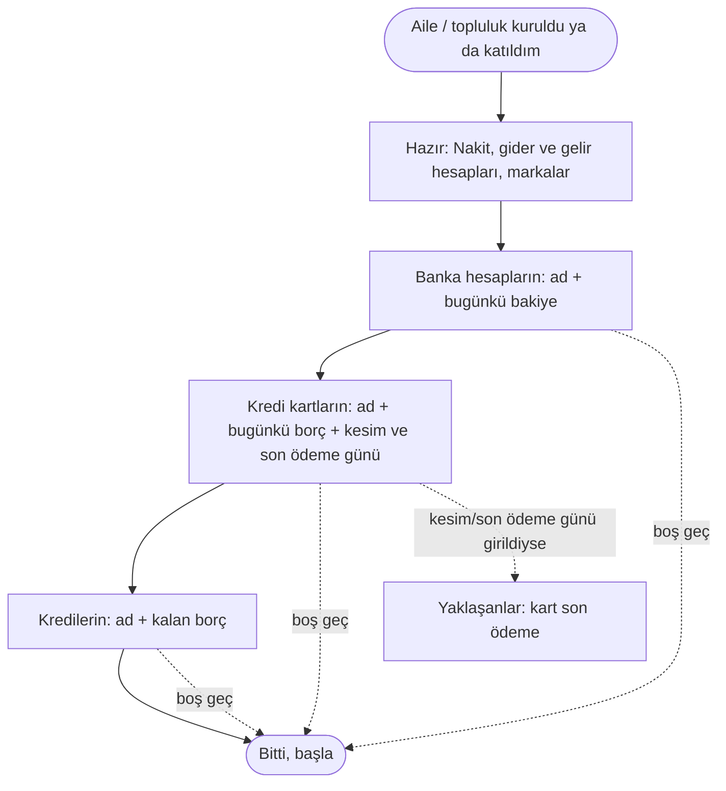

# AKS-019 — Başlangıç: bugünkü durumu girmek

- **Kaynak:** [ROADMAP](../../ROADMAP.md) hesap şablonu kararı (2026-10-08); uygulama `/baslangic`. Anlatılmadı.
- **Kim:** Yeni aile / topluluk kuran ya da birine katılan her üye
- **Tetikleyici:** İlk giriş
- **Sıklık:** Üye başına bir kez; sonra yeni hesap açıldıkça (Hesaplar sayfası)
- **Hedef:** Geçmişi yazmadan bugünden başlamak; bakiyeler bankayla aynı olsun, Yaklaşanlar ilk günden doğru olsun

## Kural
Geçmiş gider yeniden yazılmaz. Yalnız **bugünkü** bakiye ve borç girilir (açılış bakiyesi). Gider ve gelir hesapları, Nakit cüzdan ve yaygın markalar hazır gelir.

## Akış

## İstisnalar
| Durum | Bugün | Öneri |
|---|---|---|
| Süren taksitli alışveriş | Kart borcunun içinde; takvim yok | Kart ekranında "süren taksitler": kalan sayı + aylık tutar; gider yazılmaz (açık soru) |
| Süren banka kredisi | Yalnız kalan borç; Yaklaşanlar'da taksit görünmez | Kalan taksit sayısı + taksit tutarı isteğe bağlı (harita B5) |
| Açık vadeli hesap | Sihirbazda ve Hesaplar'da yolu yok; yalnız Transfer ile bugün açılır (paranın bugün bankadan çıkması gerekir) | Vadeli için açılış: anapara + oran + vade tarihi, para girişi/çıkışı olmadan (açık soru) |
| Kişilerle açık borç (iki yön) | Yolu yok; Borç her zaman para girişi/çıkışı ister | Borç'ta "para el değiştirmedi (eski borç)" seçeneği (açık soru) |
| Yabancı para hesap | Hesap formunda para birimi seçilir | — |
| Bakiye yanlış girildi | Hesaplar'dan düzeltilir | — |
| Sihirbazı yarıda bıraktım | Girilenler kalır; Hesaplar'dan devam | — |

## Sürtünme & duygu
- Kullanıcı ilk gün her şeyi girmek zorunda değil; boş geçmek serbest (İlke 2).
- Kart kesim/son ödeme günü bilinmezse Yaklaşanlar'da kart görünmez; kullanıcı neden görünmediğini anlamayabilir.

## Uygulamadaki karşılığı (şimdi)
`/baslangic`: üç kart (banka, kredi kartı, kredi), her biri "ekle" düğmesi ve eklenenlerin listesi; "Bitti, başla". Hesap formunda açılış bakiyesi ve "Sadece grup" anahtarı var.

## Açık sorular
[acik-sorular](../acik-sorular.md) (Başlangıç).
