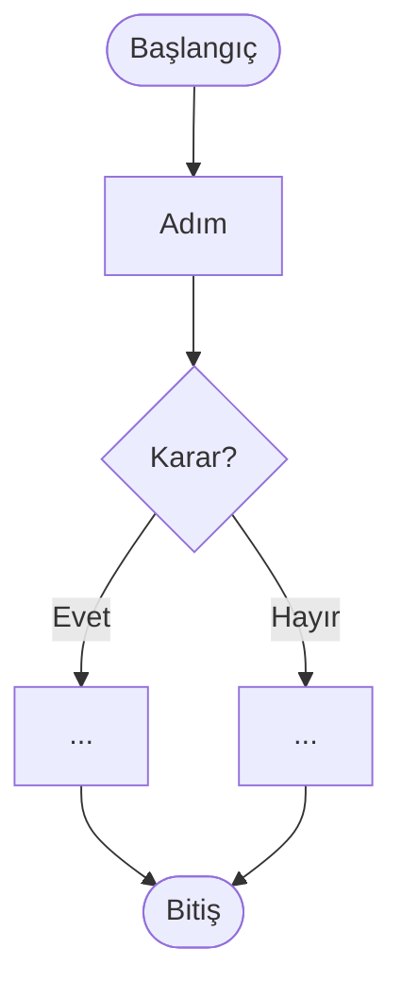

# AKS-NNN — Süreç adı

- **Tarih / kaynak:** 
- **Kim:** 
- **Tetikleyici:** (ne olunca başlar)
- **Sıklık:** (günlük/haftalık/aylık/nadir)
- **Hedef:** (kişi ne elde etmek istiyor)

## Akış

## İstisnalar / sapmalar
## Sürtünme & duygu (ne zahmetli, ne unutuluyor?)
## Uygulamadaki karşılığı (şimdi)
## Notlar / açık sorular
