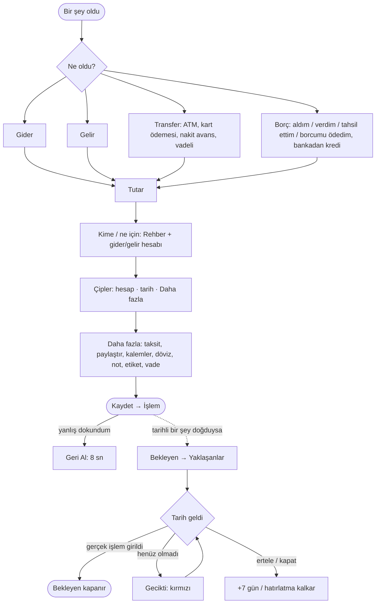

# Süreç Haritası

_Tek doğru kaynak: "şu an geçerli olan" yalnız burada. Son damıtma: 2026-10-08 (Anlatım 1-8 + [ROADMAP](../ROADMAP.md) kararları + uygulamanın bugünkü hali). Ayrıntılı istisnalar [akislar/](akislar/_indeks.md), ham anlatım [gelen-kutusu](gelen-kutusu.md), karar tarihçesi [arsiv/](arsiv/analiz.md) (dondurulmuş). Terimler: [GLOSSARY](../GLOSSARY.md)._

Etiketler: **[karar]** ürün sahibi kararı · **[uygulandı]** uygulamada var · **[öneri]** benim önerim, onay bekliyor · **[varsayım]** banka araştırması, doğrulanmadı.

---

## 1. Tek cümle

Kullanıcı yalnız **olanı** girer (**İşlem**). Uygulama bunu **kimle/nerede** olduğuna bağlar (**Rehber**) ve **ileride ne olacağını** gösterir (**Bekleyen**, Yaklaşanlar listesinde). Bekleyen bir işlem değildir; gerçek bir İşlem girilince kendiliğinden kapanır.

## 2. Altı ilke (her akış bunlara uyar)

| # | İlke | Durum |
|---|---|---|
| 1 | **İşlem = gerçekleşen.** Taksit takvimi, beklenen getiri, kredi takvimi gösterimdir, işlem değil. | [karar] [uygulandı] |
| 2 | **Varsayılanı sistem verir, kullanıcı değiştirir, boş geçmek serbest.** Son kart, markadan gider hesabı, eşit bölüşme. | [karar] [uygulandı]; son kart yerine Nakit geliyor (§8) |
| 3 | **Banka davranışı varsayılmaz.** Gerçek tutar elle girilir; beklenenle fark gelir ya da gider olur (*Fark* kalıbı). | [karar] [uygulandı] (vadeli, kredi, nakit avans) |
| 4 | **Hatanın üç çaresi:** Geri Al · Düzelt · İade. | Geri Al [uygulandı]; Düzelt kısmi; İade **yok** (§6) |
| 5 | **Yön üç işaretle:** renk + ikon + (+/−). | [karar] [uygulandı] |
| 6 | **Hatırlatma yalnız uygulama içi "Yaklaşanlar".** | [karar] [uygulandı] (Ana sayfada) |

## 3. Ana döngü

Kullanıcı açısından uygulama dört yerden ibaret:
| Yer | Soru | İçerik |
|---|---|---|
| **Hızlı işlem** | "Ne oldu?" | Dört tür: Gider · Gelir · Transfer · Borç [uygulandı] |
| **Yaklaşanlar** (Ana sayfa) | "Ne bekliyor?" | Kart son ödeme, kredi taksidi, vade günü, kişi borçları (iki yön); tarihe göre, tarihsizler altta [uygulandı] |
| **Rehber** | "Kimle?" | Kişi · marka · firma tek liste, tür süzgeci; kişide bakiye [uygulandı] |
| **İşlemler** | "Ne oldu, düzelt" | Liste, arama, tür ve etiket süzgeci, etiket toplamı; Düzelt / Sil [uygulandı] |

Hızlı işlem ekran düzeni [uygulandı]: büyük tutar en üstte · "Kime" ve "Gider hesabı" · çip satırı (hesap · tarih · Daha fazla) · seçenekler "Daha fazla" altında · Kaydet altta sabit. İlk kurulumda `/baslangic` banka, kart ve kredi sorar ([AKS-019](akislar/AKS-019-baslangic.md)).

## 4. Bütün süreçler tek tabloda

| Süreç | Giriş | Ne kaydedilir (kullanıcı dili) | Doğan Bekleyen | Bekleyeni kapatan | Durum |
|---|---|---|---|---|---|
| Kartla alışveriş · [AKS-001](akislar/AKS-001-kartla-alisveris.md) | Gider | Harcama + kart borcu | Kart son ödeme | Kart ödemesi | [uygulandı] |
| Fişte birden çok gider hesabı | Gider → Daha fazla → Kalemler | Tek işlem, gider hesabı başına satır; kalan ana gider hesabına | — | — | [uygulandı] |
| Taksitli alışveriş · [AKS-007](akislar/AKS-007-taksitli-alisveris.md) | Gider → Daha fazla → Taksitli | Tutarın tamamı harcama + kart borcu | Taksit takvimi (gösterim) | Kart ödemeleri | [uygulandı]; vade farkı açık |
| Hesabı bölüşme · [AKS-004](akislar/AKS-004-hesap-bolusme.md) | Gider → Daha fazla → Paylaştır | Benim payım harcama, diğerleri bana borçlu | Bakiye Yaklaşanlar'da | Borç → Tahsil ettim | [uygulandı] |
| Borç aldım / verdim · [AKS-005](akislar/AKS-005-borc.md) | Borç → Borç aldım / Borç verdim | Para + kişi bakiyesi (gelir/gider değil) | Vade (isteğe bağlı) | Borç → Tahsil ettim / Borcumu ödedim | [uygulandı] |
| Gelir / günlük faiz · [AKS-010](akislar/AKS-010-gunluk-faizli-hesap.md) | Gelir | Gelir + hesap; günlük faizde net yatan | — | — | [uygulandı]; stopaj ayrı değil |
| Transfer, ATM, kart ödemesi · [AKS-012](akislar/AKS-012-transfer.md) | Transfer (+ kısayol çipleri) | Hesaptan hesaba; gelir/gider yok | — | Kart ödemesi kart son ödemeyi kapatır | [uygulandı] |
| Nakit avans · [AKS-008](akislar/AKS-008-nakit-avans.md) | Transfer: kart → Nakit | Nakit + kart borcu; masraf gider | Kart son ödeme | Kart ödemesi | [uygulandı]; banka teyidi [varsayım] |
| Kredi · [AKS-009](akislar/AKS-009-kredi.md) | Borç → Borç aldım → Bankadan kredi | Hesaba yatan + toplam geri ödeme borcu; masraf ve maliyet gider | Kredi taksidi | Transfer → kredi hesabı | [uygulandı]; erken kapama yok |
| Vadeli hesap · [AKS-018](akislar/AKS-018-vadeli-hesap.md) | Transfer → "+ Yeni vadeli hesap" | Para vadesizden vadeliye; gelir yok | Vade günü | Yaklaşanlar → Yenilendi / Hesaba döndü / Erken bozdum | [uygulandı] |
| Başlangıç (açılış) · [AKS-019](akislar/AKS-019-baslangic.md) | `/baslangic` sihirbazı | Bugünkü bakiye ve borçlar | Kartta son ödeme | — | [uygulandı]; süren taksit/kredi takvimi yok |
| Kime ödedim · [AKS-016](akislar/AKS-016-kime-odeme-yaptim.md) | Her işlemde "Kime?" | Marka/kişi; firma yalnız Rehber'de | — | — | [uygulandı] |
| Etiket (tatil, proje) | Daha fazla → Etiket | #etiket; İşlemler'de süzgeç ve toplam | — | — | [uygulandı] |
| **İade** (mağaza, EFT) | **Yok** | — | — | — | **Boşluk** (§6) |
| Döviz al/sat · AKS-013 | Transfer altındaki "Diğer" bağlantısı | Eski ekran | — | — | Anlatılmadı |
| Hisse/kripto · AKS-014 | Transfer altındaki "Diğer" bağlantısı | Eski ekran | — | — | Anlatılmadı |
| Emanet yatırım · [AKS-015](akislar/AKS-015-emanet-yatirim.md) | — | Model yok | — | — | [karar] v1 sonrası |

## 5. İstisnalar altı kalıba iner

| Kalıp | Ne zaman | Ne olur | Uygulamada |
|---|---|---|---|
| **Geri Al** | Az önce yanlış girdim | İşlem hiç olmamış sayılır; bağlı Bekleyen de silinir | 8 sn "Kaydedildi · Geri al" bildirimi; çok satırlı işlem tek adımda; vadeli vade sonu geri alınınca önceki dönem döner |
| **Düzelt** | Olay doğru, alan yanlış | Alan değişir, Bekleyen yeniden hesaplanır | Yalnız sade gider/gelir: tutar, kime, gider/gelir hesabı, tarih, kalemler, etiket. **Hesap çipi değişmez.** Diğer türler: Sil + yeniden gir |
| **İade (ters işlem)** | Gerçekte geri döndü | İlk işleme bağlı ters işlem; harcama net düşer | **Yok** |
| **Fark** | Banka farklı tutar yatırdı/çekti | Gerçek tutar girilir, fark gelir veya gider | Kredi masrafı/maliyeti, vadeli getiri/masraf, nakit avans masrafı |
| **Kısmi** | Tutarın bir kısmı oldu | Kalan, Bekleyen olarak açık kalır | Tahsil ettim / Borcumu ödedim, kart ödemesi (kalan listede), vadeli kısmi çekim |
| **Kapanış** | Bekleyenin sonu | Tamamlandı · kapatıldı · gecikti | Gerçek işlemle kendiliğinden; borç vadesinde "1 hafta ertele" ve "Kapat". **Kapat bakiyeyi sıfırlamaz** (§6) |

Bilinçli ertelenenler (boşluk değil): yabancı para borç ve taksit, ATM başka banka masrafı, mutabakat/bakiye düzeltme, borç rengi, borç devri, faizli kişi borcu, kur korumalı hesap.

## 6. Uygulamaya bakarak eleştirel bulgular [öneri]

| # | Bulgu | Neden önemli | Öneri |
|---|---|---|---|
| B1 | **İade akışı yok.** Gelir olarak girilirse gelir şişer, harcama düşmez. | Her alışverişte olası; listedeki zorunlu istisna. | Gider → Daha fazla → "İade": aynı gider hesabında ve aynı hesapta ters işlem. |
| B2 | **Kart son ödeme tutarı taksitli alışverişte yanlış.** Yaklaşanlar kesim günündeki kart borcunun tamamını gösterir; 10 taksitlik 10.000 TL'nin hepsi bu ay ödenecek görünür. | "Ödedim" düğmesi yanlış tutarı doldurur; kullanıcı bankaya güvenir, uygulamaya güvenmez. | Tutar = kesimdeki borç − henüz ekstreye düşmemiş taksitler. Kullanıcı tutarı yine değiştirebilir. |
| B3 | **Düzelt'te hesap değişmiyor.** "Yanlış kart" en sık hata ([AKS-001](akislar/AKS-001-kartla-alisveris.md)). | Sil + yeniden gir iki iş. | Düzelt'e hesap çipi eklensin. |
| B4 | **"Kapat" yalnız hatırlatmayı kaldırır**; bakiye tarihsiz satır olarak listeye geri döner. Borç silme için işlem yok. | Kapanış kalıbı eksik; liste temizlenmez. | Ayrı "Borcu sil" seçeneği: bakiye kapanır; verilen için gider, alınan için gelir. |
| B5 | **Başlangıçta girilen kredi ve süren taksitler takvimsiz.** Sihirbaz yalnız kalan borcu sorar. | Yaklaşanlar en önemli iki kalemi göstermez. | [AKS-019](akislar/AKS-019-baslangic.md): "Kalan taksit sayısı ve tutarı" isteğe bağlı sorulsun. |
| B6 | **Taksit takvimi Yaklaşanlar'da değil**, Ayarlar → Taksitler'de. | İlke 6: tek liste. | Kart satırının altında "bu ay X taksit" bilgisi. |
| B7 | **Başkasının ödediği ortak hesap yok.** Paylaştır yalnız "ben ödedim". | "Arkadaş ödedi, benim payım var" sık bir durum. | Borç → Borç aldım'a "harcama için" seçeneği ya da Paylaştır'da "ödeyen" alanı. Karar gerekli. |
| B8 | **Karttan banka hesabına nakit avans** sıradan transfer sayılır; masraf sorulmaz. | Nakit avans yalnız kart → Nakit'te tanınır. | Kart → herhangi bir kendi hesabım = nakit avans. |
| B9 | **Kredi erken kapama ve vade farkı (taksit) için giriş yok.** | Karar var (Fark), ekran yok. | Kredi satırında "Erken kapattım": ödenen tutar, kalan borç maliyetten düşer. |
| B10 | **Yazım hatası Rehber'de yeni bir satır açar.** "Migros" / "Migroz" iki marka olur. | Rapor bölünür. | Rehber'de "Birleştir". |
| B12 | **ATM ilk ekrandan kalktı;** artık Transfer + kısayol = iki dokunuş. | ATM sık işlemlerdendi (Anlatım 8). | Kısayol ilk çip olarak kalsın; sık kullanılırsa Transfer açılınca seçili gelsin. |

B11 (Transfer için iki terim) 2026-10-08'de giderildi: uygulama her yerde "Transfer" yazıyor.

## 7. Karar durumu

**Kesin ve uygulandı:** Hızlı işlem dört tür (Gider · Gelir · Transfer · Borç) · ATM, kart ödemesi, nakit avans, vadeli açılış Transfer içinde · kredi Borç → Borç aldım → Bankadan kredi · Borç dört düğme (Borç aldım / Borç verdim / Tahsil ettim / Borcumu ödedim); Tahsil ettim ve Borcumu ödedim kişinin bakiyesini gösterir · taksit, paylaştır, kalemler, döviz, not, etiket "Daha fazla" altında · paylaştırda varsayılan eşit, tutar/yüzde "Payları ayrı gir" ile, artan kuruş bende, benim payım 0 olabilir · Rehber üç tür, yeni ad giderde marka, borçta kişi; marka ilk kullanılan gider hesabını öğrenir · her üyeye "Nakit" cüzdan · Geri Al 8 sn, sonra Sil · Yaklaşanlar Ana sayfada · kart kesim/son ödeme günü kart başına bir kez · kredi: toplam geri ödeme kredi günü borç, maliyet o gün gider · vadeli: anapara + yıllık oran + gün + stopaj %, vadede gerçek tutar · terimler "getiri" / "maliyet" / "masraf" · emanet yatırım v1 sonrası.

**Tasarımı bekleten açık sorular** (ayrıntı [acik-sorular](acik-sorular.md)):
1. **İade** nasıl girilsin? (B1)
2. **Kart son ödeme tutarı** taksitleri dışlasın mı? (B2)
3. **Borç silme:** gider mi, yalnız kapanış mı? (B4)
4. **Başkasının ödediği ortak hesap** v1'de mi? (B7)
5. **Taksitte vade farkı:** kredideki kural (fark = maliyet gideri, alışveriş günü) burada da geçsin mi?
6. **Banka teyitleri** (nakit avans oranı/masrafı, erken kapama, erken bozmada kâr payı, otomatik yenileme). Ürün sahibi sözleşmeden bakacak.

## 8. Uygulamayla bilinen uyumsuzluklar

| Konu | Durum |
|---|---|
| Kart son ödeme tutarı taksiti dışlamıyor | Açık (B2) |
| Sihirbazdaki kredi/kart: takvim ve süren taksit yok | Açık (B5) |
| Taksit takvimi yalnız Ayarlar → Taksitler'de | Açık (B6) |
| İşlemde firma tutulmuyor (Anlatım 6: çok firmalı markada seçilebilir) | Onay bekliyor |
| Kredi ve vade sonu formunda etiket yok | Küçük |
| Borçta "son kullanılan seçim öne çıksın" kararı uygulanmadı; hep "Borç aldım" seçili açılır | Açık |
| İlke 2 "son kart varsayılan" uygulanmadı; hesap çipi boşsa Nakit sayılır | Açık |
| Vadeli açılışta "vade sonunda hangi hesaba" sorulmuyor; vade günü sorulur | Kabul edilebilir (isteğe bağlı karardı) |

## 9. Bu belge nasıl güncellenir

İşleyiş: [README](README.md) (İşleyiş). Yeni istisna önce §5'teki kalıplara oturtulur; oturmuyorsa yeni kalıp önerilir.
