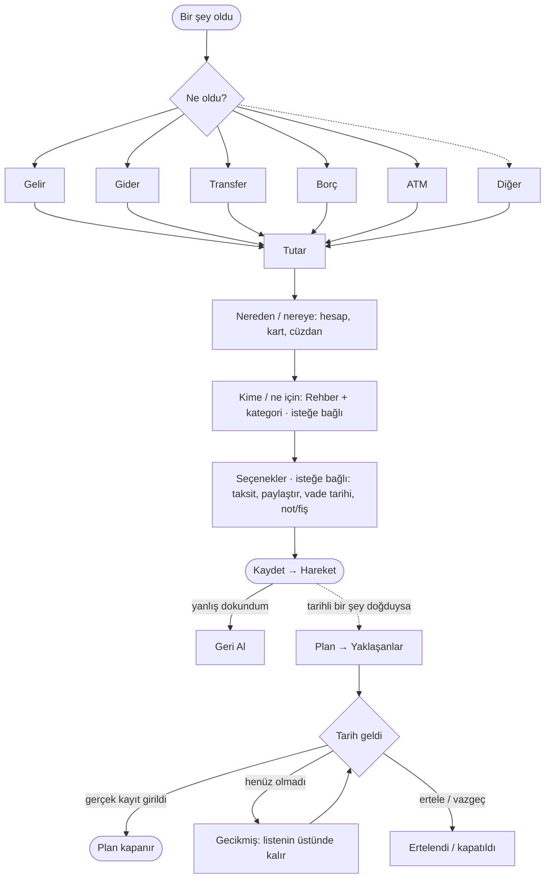

# Süreç Haritası

_Tek doğru kaynak: "şu an geçerli olan" yalnız burada. Son damıtma: 2026-10-07 (Anlatım 1-8). Ayrıntılı istisnalar [akislar/](akislar/_indeks.md), ham anlatım [gelen-kutusu](gelen-kutusu.md), karar tarihçesi [arsiv/](arsiv/analiz.md) (dondurulmuş)._

Etiketler: **[karar]** ürün sahibi kararı · **[öneri]** benim önerim, onay bekliyor · **[varsayım]** banka araştırması, doğrulanmadı.

---

## 1. Tek cümle

Kullanıcı yalnız **olanı** girer (**Hareket**). Uygulama bunu **kimle/nerede** olduğuna bağlar (**Rehber**) ve **ileride ne olacağını** gösterir (**Plan**). Plan bir kayıt değildir; gerçek bir Hareket girilince kendiliğinden kapanır.

## 2. Altı ilke (her akış bunlara uyar)

1. **Kayıt = gerçekleşen.** Taksit takvimi, beklenen getiri, kredi takvimi, "bugünkü tahmini borç" kayıt değil, gösterimdir. [karar]
2. **Varsayılanı sistem verir, kullanıcı değiştirir, boş geçmek serbest.** Son kart, markadan kategori, eşit bölüşme, firma "belirsiz". [karar]
3. **Banka davranışı varsayılmaz.** Gerçek yatan/çekilen tutar elle girilir; beklenenle fark otomatik gelir ya da gider olur (bkz. *Fark* kalıbı). [karar]
4. **Hatanın üç ayrı çaresi:** Geri Al ("yanlış dokundum") · Düzelt ("alan yanlış") · İade ("gerçekten geri geldi"). Geri Al v1'de var. [karar]
5. **Yön üç işaretle:** renk + ikon + (+/−). Renk tek başına yetmez. [karar]
6. **Hatırlatma yalnız uygulama içi "Yaklaşanlar".** Telefon bildirimi yok. [karar]

## 3. Ana döngü

Bütün süreçler bu tek döngünün çeşitleridir.

Kullanıcı açısından uygulama üç yerden ibaret:
| Yer | Soru | İçerik |
|---|---|---|
| **Hızlı Kayıt** | "Ne oldu?" | Ana döngünün üst yarısı |
| **Yaklaşanlar** | "Ne bekliyor?" | Tüm Plan'lar tek listede, tarihe göre, gecikmiş üstte |
| **Rehber** | "Kimle?" | Kişi · marka (· firma arka planda) |

## 4. Bütün süreçler tek tabloda

| Süreç | Giriş | Ne kaydedilir (kullanıcı dili) | Doğan Plan | Planı kapatan | Durum |
|---|---|---|---|---|---|
| Kartla alışveriş · [AKS-001](akislar/AKS-001-kartla-alisveris.md) | Gider | Harcama + kart borcu | Kart son ödeme | Kart ödemesi | Net |
| Taksitli alışveriş · [AKS-007](akislar/AKS-007-taksitli-alisveris.md) | Gider → taksitli | **Tutarın tamamı** harcama + kart borcu | Ekstre taksit takvimi | Kart ödemeleri | Net; vade farkı açık |
| Hesabı bölüşme · [AKS-004](akislar/AKS-004-hesap-bolusme.md) | Gider → paylaştır | Benim payım harcama, diğerleri bana borçlu | "X ödemedi" | Borç → Ödeşme | Net |
| Borç aldım / verdim · [AKS-005](akislar/AKS-005-borc.md) | Borç → Aldım / Verdim | Para + kişi bakiyesi (gelir/gider değil) | Vade (isteğe bağlı) | Borç → Ödeşme | Net |
| Gelir | Gelir | Gelir + hesap | — | — | Net |
| Günlük faiz · [AKS-010](akislar/AKS-010-gunluk-faizli-hesap.md) | Gelir (faiz) | Net yatan faiz, kesinti görünür | — | — | Net |
| Transfer · AKS-012 | Transfer | Hesaptan hesaba; gelir/gider yok | — | — | Net |
| ATM · AKS-002/003 | ATM → Çek / Yatır | Hesap ↔ cüzdan, cüzdan sorulmaz | — | — | Net |
| **Kart ödemesi** | Transfer → karta [öneri] | Hesap azalır, kart borcu azalır | — | Kart son ödemeyi kapatır | **Hiç yazılmamış** |
| Vadeli hesap · [AKS-018](akislar/AKS-018-vadeli-hesap.md) | Diğer → vadeli | Para vadesizden vadeliye; gelir yok | Vade günü | Vade sonu kaydı (yenilendi / döndü / kısmi) | Akış net; banka teyidi |
| Nakit avans · [AKS-008](akislar/AKS-008-nakit-avans.md) | Diğer → nakit avans | Nakit + kart borcu; komisyon harcama | Kart son ödeme | Kart ödemesi | [varsayım] |
| Kredi · [AKS-009](akislar/AKS-009-kredi.md) | Diğer → kredi | Hesaba net tutar + borç; masraf harcama | Taksit takvimi | Taksit ödemesi | [varsayım] |
| Döviz al/sat · AKS-013 | Diğer | — | — | — | Anlatılmadı |
| Hisse/kripto · AKS-014 | Diğer | (uygulamada var) | — | — | Anlatılmadı |
| Emanet yatırım · [AKS-015](akislar/AKS-015-emanet-yatirim.md) | Diğer | **Model yok** (pay/birim değeri adayı) | Babaya rapor dönemi | — | En zor; ilerlemedi |
| Kime ödedim · [AKS-016](akislar/AKS-016-kime-odeme-yaptim.md) | Her kayıtta "Kime?" | Marka yazılır, firma arka planda/boş | — | — | Net |

## 5. İstisnalar altı kalıba iner

Akış başına 10-15 satırlık matris yerine her istisna şu altı kalıptan biridir. Yeni bir akışta "bu istisna hangi kalıp?" diye sormak yeter.

| Kalıp | Ne zaman | Ne olur | Örnekler |
|---|---|---|---|
| **Geri Al** | Az önce yanlış girdim | Kayıt hiç olmamış sayılır; bağlı Plan da düzelir | Yanlış yön borç, çift dokunuş |
| **Düzelt** | Olay doğru, alan yanlış | Alan değişir, Plan yeniden hesaplanır | Yanlış kart, kategori, oran |
| **İade (ters hareket)** | Gerçekte geri döndü | İlk kayda bağlı ters kayıt; harcama net düşer | Mağaza iadesi, EFT iadesi, ATM'den para çıkmadı, kredi cayma |
| **Fark** | Banka beklenenden farklı tutar yatırdı/çekti | Gerçek tutar girilir, fark gelir veya gider olur | Erken kapama indirimi, erken bozma cezası, kredide net ele geçen, komisyon, gecikme faizi |
| **Kısmi** | Tutarın bir kısmı oldu | Kalan, Plan'da açık kalır | Kısmi ödeşme, karta asgari ödeme, vadeli kısmi çekim |
| **Kapanış** | Plan'ın sonu | Tamamlandı · vazgeçildi (borç bağışlandı) · gecikmiş. Açıkta kalan olmaz | Takvim bitti, vade sonu, alacaktan vazgeçme |

Bilinçli ertelenenler (boşluk değil): yabancı para, ATM başka banka komisyonu, mutabakat/bakiye düzeltme, borç rengi, borç devri, faizli kişi borcu, kur korumalı hesap.

## 6. Sadeleştirme önerisi: "Diğer"i boşaltmak [öneri]

Bugün "Diğer" altında altı ağır süreç var (vadeli, nakit avans, kredi, döviz, yatırım, emanet). Çoğu aslında ilk ekrandaki beş düğmenin bir çeşidi:

| Süreç | Yeni giriş [öneri] | Gerekçe |
|---|---|---|
| Nakit avans | **ATM → Çek**, kaynak kredi kartı seçilince | Kullanıcı için olay aynı: ATM'den para çektim. Kart seçilince sistem nakit avans olduğunu bilir. |
| Kart ödemesi | **Transfer**, hedef kart | Para hesaptan karta gitti. |
| Vadeli hesap açma | **Transfer**, hedef vadeli hesap | Para yer değiştirdi; vade/oran hesabın özelliği. |
| Vade sonu, erken bozma | **Yaklaşanlar'daki satırdan** | Olay zaten listede bekliyor; oradan kaydedilir. |
| Kredi | **Borç → Aldım**, kimden: banka | Kişiden borç almakla aynı şekil; banka Rehber'de kurum. Ek alanlar (taksit, masraf) "daha fazla" altında. |
| Günlük faiz | **Gelir**, kategori faiz | Zaten öyle. |

Sonuç: "Diğer" yalnız **döviz, yatırım, emanet** kalır. Hızlı Kayıt beş düğme + küçük "Diğer" bağlantısı olur. Bedeli: kredi ve nakit avansın ayrı bir "yeri" olmaz; kullanıcı onları Gider/Borç/ATM'nin içinde bulmalı.

## 7. Karar durumu

**Kesin (değişmez varsayılır):** ilk ekran Gelir · Gider · Transfer · Borç · ATM; Borç tek düğme (Aldım/Verdim/Ödeşme) · taksit ve paylaştır Gider'in seçeneği · paylaştırda varsayılan eşit, tutar/yüzde "daha fazla" altında · Rehber (kişi/firma/marka) ve Rehber sayfası v1'de · cüzdan tek nakit hesabı, ATM sormaz · günlük faiz elle, işlem esaslı · vadeli: beklenen getiri gösterilir, yenileme/erken bozma kapsamda · nakit avans ve kredi v1'de · Geri Al v1'de · bildirim yalnız Yaklaşanlar · önce sağlam elle giriş, sadeleştirme/entegrasyon sonra.

**Tasarımı bekleten açık sorular** (geri kalanı [acik-sorular](acik-sorular.md)'de ayrıntı):
1. **Emanet yatırım v1'de mi?** 8 anlatımda ilerlemedi, modeli yok, en zor konu. [öneri: v1 sonrası; v1'de baba yalnız Rehber kişisi]
2. **Kart ödemesi akışı** hiç yazılmamış; taksit, nakit avans ve kart son ödemenin hepsi ona bağlı. [öneri: Transfer → kart]
3. **Kart kesim/son ödeme günü** kart başına bir kez girilsin mi? Yaklaşanlar'ın kart kısmı buna bağlı. [öneri: evet]
4. **Bölüm 6'daki "Diğer"i boşaltma** önerisi.
5. **Vade farkı / kâr payı muhasebesi** (taksit + kredi aynı soru) — "sonra" kararı var; kredi akışı bu karar olmadan çizilemez.
6. **Geri Al kapsamı** (süre, çok satırlı kayıtlar). [öneri: son kayıt hemen; sonrası Düzelt/Sil; çok satırlı kayıt tek adımda]
7. **Terim:** faiz / kâr payı / getiri. [öneri: nötr "getiri" ve "maliyet"]
8. **Banka teyitleri** (nakit avans oranı/komisyonu, erken kapama, erken bozmada kâr payı, otomatik yenileme). Ürün sahibi sözleşmeden bakacak.

**Toplu kapatma önerisi:** [acik-sorular](acik-sorular.md)'deki "(Öneri: …)" yazan ~25 küçük soru için itiraz yoksa öneri karar sayılsın.

## 8. Mevcut uygulamayla bilinen uyumsuzluklar (kod okunmadı, kontrol edilecek)

- `installment-create/pay` + Taksitler sayfası: gelecek taksitler ileri tarihli kayıt mı? (İlke 1'e aykırı olabilir.)
- `contacts`: kişi/firma/marka ayrımı ve çoktan-çoğa marka–firma yok.
- Plan/Yaklaşanlar için tarih nesnesi yok; borçta vade, kartta kesim/son ödeme günü alanı yok.
- Vadeli hesap (vade, oran, yenileme, dönem geçmişi) ve kredi (net/brüt, takvim) için alan yok.
- ATM akışında hâlâ "hesap seç" adımı olabilir (cüzdan otomatik olmalı).

## 9. Bu belge nasıl güncellenir

İşleyiş: [README](README.md) (İşleyiş). Yeni istisna önce §5'teki kalıplara oturtulur; oturmuyorsa yeni kalıp önerilir.
